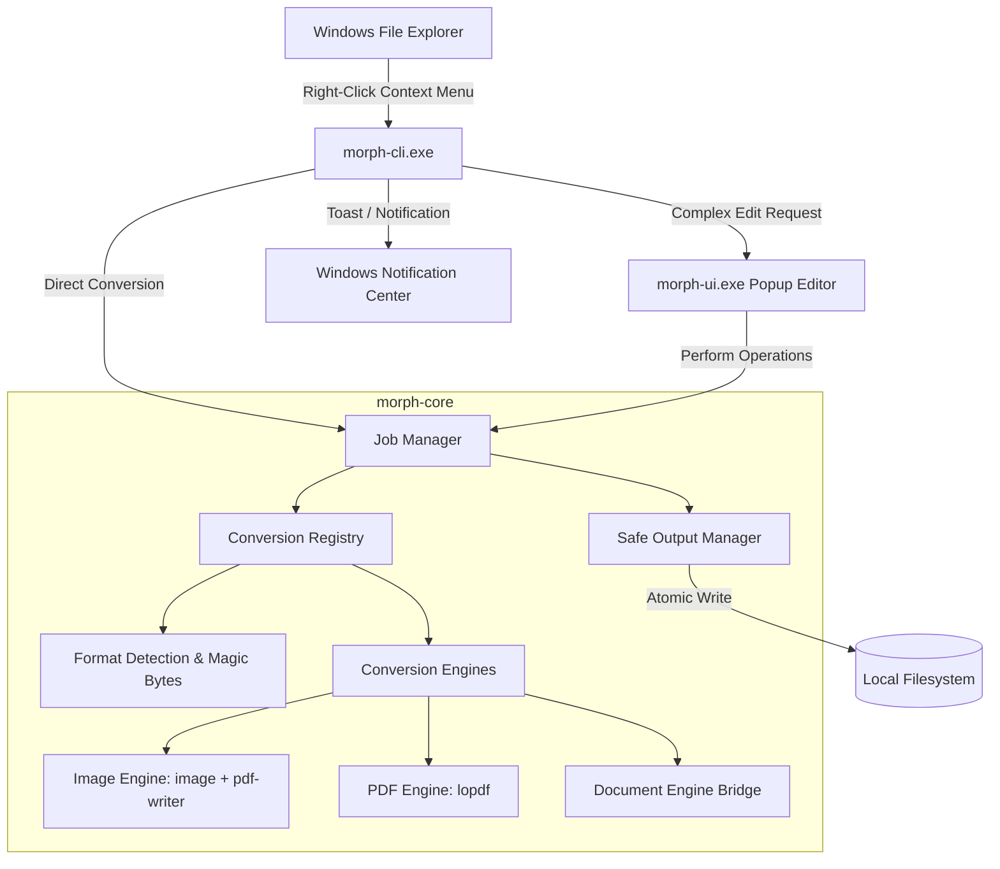

# Morph Technical Architecture

## Architectural Principles

Morph is engineered with the following architectural commitments:

1. **Clean Separation of Concerns**: Core conversion logic (`morph-core`) is completely detached from the operating system shell and user interface frameworks.
2. **Capability-Based Registration**: Conversions are not hardcoded ad-hoc; they are registered with explicit input/output formats, offline capabilities, dependency requirements, and execution models.
3. **Safe File Handling**:
   - Zero in-place overwriting without explicit user confirmation.
   - Outputs default to the same directory as the source input.
   - Non-destructive naming with collision resolution: `filename (1).ext`.
   - Atomic output writes: Work is written to temporary staging files (`.morph-tmp-XXXX`), validated for integrity, and then finalized into the target destination.
4. **Offline and Private by Default**: No network sockets opened during normal execution. No telemetry, no remote telemetry pings, and no cloud-dependent components.
5. **Structural Integrity**: For documents like PDF, structural transformations (page reordering, rotation, deletion, merging) manipulate internal PDF object trees (cross-reference tables, page dictionaries) rather than rasterizing pages into bitmaps, preserving selectable text, vector graphics, and metadata.

---

## Workspace Architecture

---

## Component Details

### 1. `morph-core`
- **`detection`**: Inspects file headers (magic bytes) to identify true MIME types regardless of file extensions. Defends against mismatched or obfuscated extensions.
- **`format`**: Strongly typed format enum (`Format::Png`, `Format::Pdf`, `Format::Docx`, etc.) categorized into `FormatCategory` (Image, Document, Audio, Video, Archive).
- **`registry`**: Registry holding conversion descriptors (`ConversionOperation`):
  - `source`: Supported input format(s).
  - `target`: Output format.
  - `offline`: Boolean flag confirming zero network requirement.
  - `interactive`: Whether user interaction (popup) is required or if it can run instantly.
  - `lossless`: Whether the operation preserves fidelity without raster degradation.
- **`output`**: Provides `OutputManager`:
  - `resolve_target_path`: Calculates non-colliding destination path.
  - `create_temp_target`: Allocates safe sibling temporary file.
  - `finalize`: Validates byte length and structure, then moves temp file to target destination atomically.
  - `cleanup`: Deletes leftover temporary artifacts if conversion fails.
- **`job`**: Lifecycle state machine: `Queued -> Running -> Validating -> Completed` or `Failed(MorphError)`.

### 2. `morph-cli`
- The fast entry point invoked by Windows Explorer context menu items or command-line scripts.
- Dispatches instant conversions in < 50ms without opening a heavy window.
- Handles Windows command-line quoting, UNC paths, long paths (`\\?\`), and spaces safely.
- Emits Windows native toast notifications upon job completion or failure.

### 3. Context Menu Integration Strategy
Windows 11 provides two context menu layers:
1. **Modern Context Menu**: In Windows 11, top-level context menu entries require a Sparse MSIX Package or COM IExplorerCommand shell extension.
2. **Classic Context Menu & SystemFileAssociations**:
   - Registered under `HKCU\Software\Classes\SystemFileAssociations\<ext>\shell\Morph.<action>`.
   - Requires zero administrator privileges.
   - Extremely reliable, instant, and clean.
   - Supports custom icons, cascading subcommands via `MUIVerb` and `SubCommands`.
   - Accessible via Shift+F10 or the Windows 10/11 classic context menu.
- Morph registers clean per-user verbs under `HKCU\Software\Classes\SystemFileAssociations` with clean unregistration.

### 4. `morph-ui`
- Compact, lightweight popup window invoked only when interactive arrangement is required (e.g. multi-image merge, PDF page deletion/rotation/reordering).
- Built with pure native Rust GUI (`egui`/`eframe`), ensuring instantaneous load time, low memory footprint (<40MB RAM), zero webview/Electron overhead, and full offline operation.
- **Top Shelf Layout Architecture**:
  - Uses an isolated dual-column layout: right-to-left dock for action buttons (`Add Files...`, Insertion mode segmented dock) and left-to-right clipped scroll area for source file chips.
  - Converts mouse vertical scroll wheel deltas to horizontal scrolling over chip containers.
  - Interactive `Files (N) ▾` popup dropdown for fast vertical navigation across all loaded files.
- **Non-Blocking Asynchronous Background Pipeline**:
  - File loading returns in <10ms by queueing page thumbnail extraction to a dedicated background channel (`thumb_queue_tx`), ensuring fluid 60 FPS UI interaction even with large multi-page documents.
  - In-flight preview deduplication (`pending_previews`) ensures zero duplicate renders for concurrent page requests.
- **Multi-Tier GPU Texture Pipeline**:
  - Employs a 4-tier fallback: dedicated rotated thumbnails -> dedicated rotated previews -> base unrotated thumbnail with GPU vertex rotation (`egui::Image::rotate`) -> base preview with GPU vertex rotation.
  - Rotations execute at 60 FPS on the GPU with zero disk latency and zero blank frames.
- **Cache Lifecycle Management**:
  - High-res previews and thumbnails reside in `%TEMP%\morph_thumbs\`.
  - Automatically deletes document preview files upon file removal (`✕`), purges session temporary files upon window exit (`on_exit`), and auto-prunes stale cache files older than 24 hours on startup.
- **Binary Branding**:
  - Multi-resolution icons (`16px`, `24px`, `32px`, `48px`, `64px`, `128px`, `256px`) embedded directly into PE executables via `winres` at compile time.

### 5. Compression & File Size Optimization Architecture

The compression pipeline in `morph-core` is engineered with a multi-layered architecture balancing lossless structural fidelity and extreme byte reduction:

1. **Lossless Structural Stream Optimization (`lopdf` + `flate2`)**:
   - Recompresses all internal content streams and object dictionaries using maximum DEFLATE compression levels (`Compression::best()`).
   - Converts standard cross-reference tables into modern compact Cross-Reference Streams (`/XRef`) and packs non-stream objects into Object Streams (`/ObjStm`, PDF 1.5+).
   - Traverses the internal object graph from the `/Root` catalog to identify and prune unreferenced/orphan objects, stale metadata streams (`/Metadata`), embedded preview thumbnails (`/Thumb`), and incremental update history.

2. **Raster Downsampling & Modern Re-Encoding Pipeline**:
   - Scans and extracts embedded `/XObject` image dictionaries (`/Subtype /Image`).
   - Calculates effective DPI against page bounding boxes and downsamples high-resolution images (300+ DPI) to target resolution thresholds:
     - **Email / Balanced**: ~150 DPI clamp with ~75% DCT/JPEG quality.
     - **Screen / Web**: ~96 DPI clamp with ~65% DCT/JPEG quality.
     - **Maximum Reduction**: ~72 DPI clamp with optional 8-bit grayscale conversion for scanned documents.
   - Re-encodes raw, uncompressed, or bloated bitmap streams into optimized JPEG or WebP streams.

3. **Target File Size Solver (Bisection Optimization)**:
   - When a user or agent specifies a strict file size ceiling (e.g. `--target-size 2MB` or UI target box):
     - Runs a bounded binary search (bisection) over quality (15% to 90%) and scale factors (0.3x to 1.0x).
     - Rapidly estimates compressed stream sizes in-memory without disk I/O, converging in 3–4 iterations to the highest visual fidelity that remains strictly under the byte limit.

4. **Privacy & Metadata Sanitization**:
   - Strips non-critical ancillary metadata (EXIF tags, GPS coordinates, author names, printer profiles, software timestamps, and comments), maximizing privacy while saving unnecessary file overhead.

