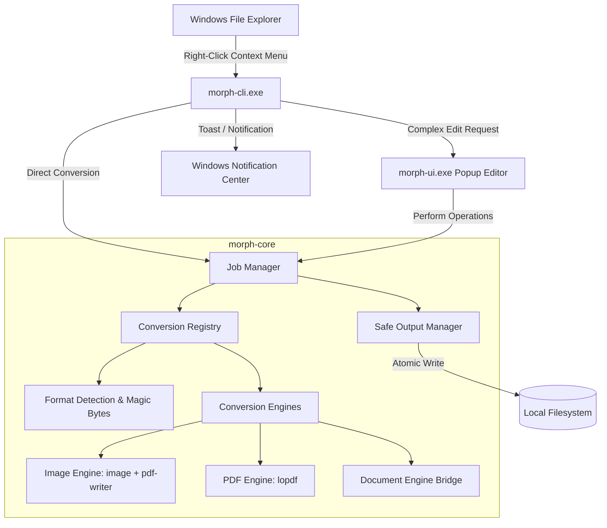

# Morph Technical Architecture

## Architectural Principles

Morph is engineered with the following architectural commitments:

1. **Clean Separation of Concerns**: Core conversion logic (`morph-core`) is completely detached from the operating system shell and user interface frameworks.
2. **Capability-Based Registration**: Conversions are not hardcoded ad-hoc; they are registered with explicit input/output formats, offline capabilities, dependency requirements, and execution models.
3. **Safe File Handling**:
   - Zero in-place overwriting without explicit user confirmation.
   - Outputs default to the same directory as the source input.
   - Non-destructive naming with collision resolution: `filename (1).ext`.
   - Atomic output writes: Work is written to temporary staging files (`.morph-tmp-XXXX`), validated for integrity, and then finalized into the target destination.
4. **Offline and Private by Default**: No network sockets opened during normal execution. No telemetry, no remote telemetry pings, and no cloud-dependent components.
5. **Structural Integrity**: For documents like PDF, structural transformations (page reordering, rotation, deletion, merging) manipulate internal PDF object trees (cross-reference tables, page dictionaries) rather than rasterizing pages into bitmaps, preserving selectable text, vector graphics, and metadata.

---

## Workspace Architecture

---

## Component Details

### 1. `morph-core`
- **`detection`**: Inspects file headers (magic bytes) to identify true MIME types regardless of file extensions. Defends against mismatched or obfuscated extensions.
- **`format`**: Strongly typed format enum (`Format::Png`, `Format::Pdf`, `Format::Docx`, etc.) categorized into `FormatCategory` (Image, Document, Audio, Video, Archive).
- **`registry`**: Registry holding conversion descriptors (`ConversionOperation`):
  - `source`: Supported input format(s).
  - `target`: Output format.
  - `offline`: Boolean flag confirming zero network requirement.
  - `interactive`: Whether user interaction (popup) is required or if it can run instantly.
  - `lossless`: Whether the operation preserves fidelity without raster degradation.
- **`output`**: Provides `OutputManager`:
  - `resolve_target_path`: Calculates non-colliding destination path.
  - `create_temp_target`: Allocates safe sibling temporary file.
  - `finalize`: Validates byte length and structure, then moves temp file to target destination atomically.
  - `cleanup`: Deletes leftover temporary artifacts if conversion fails.
- **`job`**: Lifecycle state machine: `Queued -> Running -> Validating -> Completed` or `Failed(MorphError)`.

### 2. `morph-cli`
- The fast entry point invoked by Windows Explorer context menu items or command-line scripts.
- Dispatches instant conversions in < 50ms without opening a heavy window.
- Handles Windows command-line quoting, UNC paths, long paths (`\\?\`), and spaces safely.
- Emits Windows native toast notifications upon job completion or failure.

### 3. Context Menu Integration Strategy
Windows 11 provides two context menu layers:
1. **Modern Context Menu**: In Windows 11, top-level context menu entries require a Sparse MSIX Package or COM IExplorerCommand shell extension.
2. **Classic Context Menu & SystemFileAssociations**:
   - Registered under `HKCU\Software\Classes\SystemFileAssociations\<ext>\shell\Morph.<action>`.
   - Requires zero administrator privileges.
   - Extremely reliable, instant, and clean.
   - Supports custom icons, cascading subcommands via `MUIVerb` and `SubCommands`.
   - Accessible via Shift+F10 or the Windows 10/11 classic context menu.
- Morph registers clean per-user verbs under `HKCU\Software\Classes\SystemFileAssociations` with clean unregistration.

### 4. `morph-ui`
- Compact, lightweight popup window invoked only when required (e.g. multi-image merge, PDF page deletion/rotation/reordering).
- Built with pure native Rust GUI (`egui`/`eframe`), ensuring instantaneous load time, low memory footprint, zero webview/electron overhead, and full cross-platform compatibility with future macOS support.
