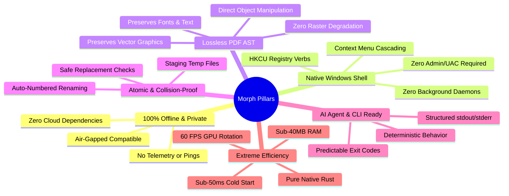
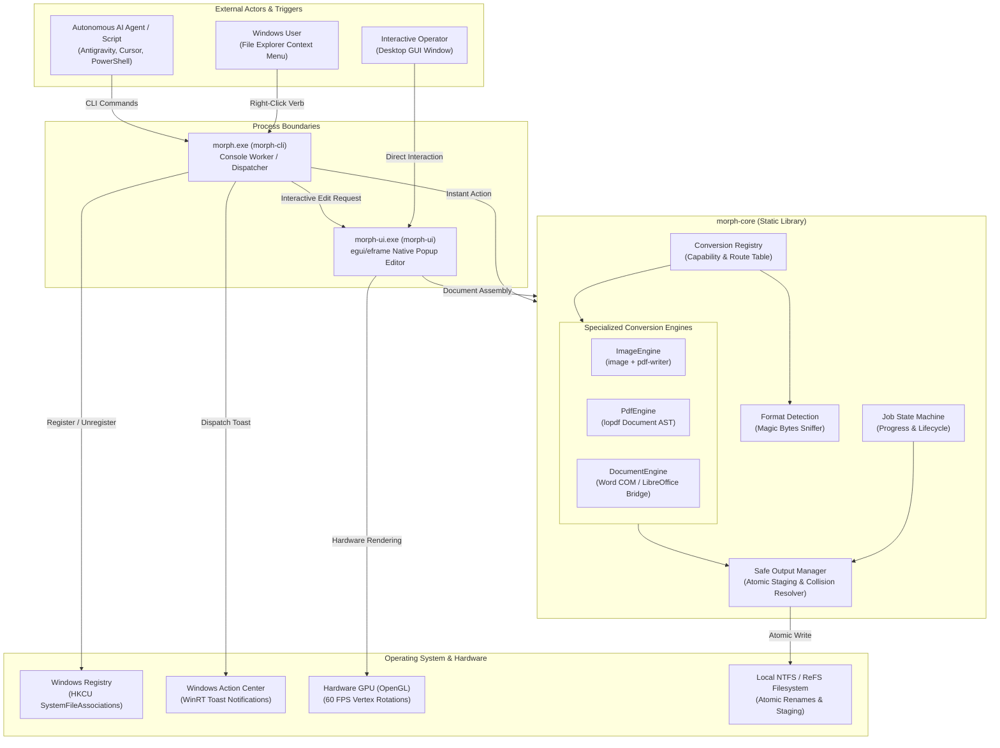

# 00: Project Overview & Core Philosophy

## 1. Executive Summary

**Morph** is a native, offline-first, universal file conversion engine and interactive document editor engineered specifically for Microsoft Windows 10 and 11. Built entirely in modern systems-level Rust, Morph bridges the gap between lightweight operating system shell utilities and heavyweight professional document editing suites.

The project addresses three fundamental shortcomings of modern document utilities:
1. **Privacy Risks of Cloud-Based Converters**: Most web converters (e.g., Smallpdf, CloudConvert) require uploading sensitive personal, legal, financial, or proprietary corporate documents to remote third-party servers.
2. **Resource Bloat of Modern Desktop Software**: Tools built with Electron, Chromium Embedded Framework (CEF), or bloated .NET frameworks frequently consume 300MB–800MB of RAM, take multiple seconds to launch, and require heavy background daemons or autostart services.
3. **Destructive Document Degradation**: Many consumer PDF utilities convert vector documents into intermediate raster images before re-encoding them, destroying selectable text, embedded fonts, hyperlink annotations, and high-resolution vector geometry.

Morph solves these problems by providing instantaneous, native right-click conversions directly inside Windows File Explorer, a headless CLI designed for automated scripting and autonomous AI coding agents, and a compact GPU-accelerated desktop editor (`morph-ui.exe`) consuming under 40 MB of RAM with sub-50ms cold starts.

---

## 2. Core Architectural Pillars

### Pillar 1: Offline-First & Absolute Privacy
Morph does not establish network connections during runtime. There are zero outbound HTTP requests, zero analytical beacons, zero crash report uploads, and zero license check pings. All processing occurs entirely within the local host CPU and GPU memory space. This makes Morph compliant with air-gapped security boundaries, defense-in-depth protocols, and strict enterprise privacy standards (GDPR, HIPAA, and internal corporate data protection policies).

### Pillar 2: Native Windows Shell Integration Without Administrative Overhead
Unlike legacy Windows utilities that install COM shell extensions (`IExplorerCommand`) into system-wide protected registry paths (`HKEY_LOCAL_MACHINE`) requiring administrative UAC elevation and system reboots, Morph utilizes per-user `SystemFileAssociations` registered under `HKEY_CURRENT_USER\Software\Classes\SystemFileAssociations`.
- **Zero Administrator Privileges**: Installs and uninstalls cleanly for standard unprivileged users.
- **Zero Explorer Latency**: Because Morph registers static shell verbs rather than executing in-process shell DLLs, right-clicking files in File Explorer suffers zero delay or process hang risks.
- **Zero Background Services**: No daemons, background watchers, or persistent services sit idle in the Windows Task Manager. The process exists strictly while performing work.

### Pillar 3: Structural Integrity Over Rasterization
A critical architectural commitment of `morph-core` is lossless document transformation:
- When merging, rotating, deleting, reordering, or splitting PDF files, Morph parses and manipulates the internal PDF Document Object Graph (cross-reference tables, page dictionaries, and content stream objects) using `lopdf`.
- Text streams, font descriptors, embedded vector curves, metadata, and color spaces remain completely untouched.
- When converting raster images into PDF format, Morph avoids re-compressing JPEG bitstreams; it leverages PDF `/DCTDecode` filters to directly embed raw JPEG bytes into the PDF container, guaranteeing 100% mathematical fidelity and instantaneous execution.

### Pillar 4: Collision-Proof & Atomic File Handling
Accidental data loss is strictly prevented:
- **Never In-Place Overwrite by Default**: Converted outputs are written to the source directory using intelligent collision resolution: if `invoice.pdf` exists, Morph automatically writes `invoice (1).pdf`, `invoice (2).pdf`, etc.
- **Atomic Staging**: Conversions write intermediate data to hidden sibling temporary files (`.morph-tmp-XXXXXX`). Only after the operation completes successfully and passes size and format integrity checks is the file atomically finalized into its target destination via the operating system's filesystem rename primitive (`MoveFileExW` / `fs::rename`). If an error occurs, staging files are automatically purged, leaving the user's filesystem clean.

### Pillar 5: Agentic AI & Automation Ready
Morph is explicitly architected to serve as a low-level tool for autonomous AI coding agents (such as Google Antigravity, Claude Code, GitHub Copilot, Cursor, and Windsurf) and automated batch scripts:
- Clean, machine-readable command-line interface (`morph convert`, `morph merge`, `morph pdf rotate`).
- Deterministic exit codes (`0` for success, `1` for error).
- Separate console and GUI dispatch logic: when invoked from a terminal, `morph.exe` attaches to the parent console to stream progress; when invoked from Windows Explorer, it runs silently without opening unwanted command prompt windows, communicating through native Windows Toast notifications.

### Pillar 6: High Performance Native Runtime
- **Language**: 100% Safe Systems-level Rust (MSVC toolchain).
- **GUI Framework**: Native immediate-mode GUI (`egui` / `eframe` via Hardware OpenGL/Glow).
- **Startup Time**: Cold start to first interactive frame in under 50 milliseconds.
- **Memory Footprint**: Active workspace baseline memory usage hovers between 25MB and 45MB RAM.

---

## 3. High-Level System Topology

The diagram below illustrates how external actors (human users via File Explorer, interactive GUI operators, and autonomous AI agents) interact with Morph's execution boundaries:

---

## 4. Key Differentiators Matrix

| Dimension | Typical Web Converters | Traditional PDF Software (Adobe/Foxit) | Electron-Based Utilities | Morph |
| :--- | :--- | :--- | :--- | :--- |
| **Data Privacy** | ❌ Files uploaded to remote cloud | ⚠️ Telemetry & cloud synchronization | ⚠️ Periodic cloud updates & telemetry | ✅ **100% Offline; Zero network calls** |
| **Startup Latency** | ❌ Browser navigation required | ⚠️ 2.0s – 5.0s heavy launch | ❌ 1.5s – 4.0s startup | ✅ **< 50ms native cold start** |
| **RAM Footprint** | ❌ 300MB – 1GB (Browser tab) | ❌ 200MB – 600MB | ❌ 350MB – 800MB | ✅ **< 40MB RAM** |
| **OS Integration** | ❌ None (Manual upload/download) | ⚠️ Heavy shell COM DLLs & background services | ❌ Standalone window only | ✅ **Per-user static registry verbs** |
| **Admin Rights** | N/A | ❌ Mandatory for installation | ⚠️ Often required for system-wide install | ✅ **Zero admin privileges required** |
| **PDF Fidelity** | ❌ Frequent raster degradation | ✅ High vector fidelity | ⚠️ Often wraps PDF.js canvas | ✅ **Direct lossless AST manipulation** |
| **Automation** | ❌ Paid REST API rate limits | ⚠️ Complex COM / enterprise scripting | ❌ No headless CLI | ✅ **First-class CLI for AI Agents** |

---

## 5. Summary & Reading Progression

Morph was engineered to be clean, modular, and uncompromisingly robust. The subsequent chapters in this deep dive break down every technical dimension of the project:
- In [**`01-complete-repository-structure.md`**](file:///c:/Morph/docs/codebase-deep-dive/01-complete-repository-structure.md), we inventory every crate, file, asset, and installer definition in the repository.
- In [**`02-programming-language-fundamentals.md`**](file:///c:/Morph/docs/codebase-deep-dive/02-programming-language-fundamentals.md), we teach the Rust language mechanics underpinning the entire codebase.
- In [**`04-system-architecture.md`**](file:///c:/Morph/docs/codebase-deep-dive/04-system-architecture.md) and [**`06-file-by-file-code-explanation.md`**](file:///c:/Morph/docs/codebase-deep-dive/06-file-by-file-code-explanation.md), we dissect every component down to the individual lines of code.

