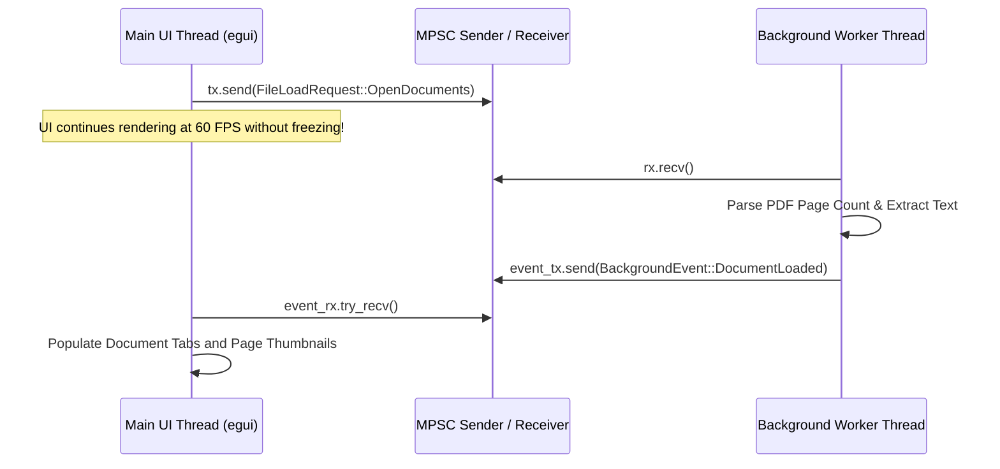

# 02: Programming Language Fundamentals (Rust & Supporting Runtimes)

This chapter provides a complete, ground-up guide to the programming languages utilized in **Morph**. It assumes no prior familiarity with low-level systems programming and teaches each core language mechanism from first principles, followed by real code examples taken directly from this codebase.

---

## Part 1: The Rust Programming Language

### 1. What Rust Is & Why Morph Uses It

Rust is a statically typed, ahead-of-time compiled systems programming language created to provide **memory safety without a garbage collector**, **zero-cost abstractions**, and **fearless concurrency**.

#### Why Morph Uses Rust
File manipulation utilities, PDF engines, and operating system shell extensions operate under strict performance and reliability requirements:
1. **Zero Garbage Collection Stutters**: In UI and shell operations, pauses caused by garbage collection (common in C#, Java, or JavaScript) introduce noticeable click-to-menu delays. Rust has no garbage collector; memory is reclaimed deterministically at compile-time defined points.
2. **Memory Safety Without Overhead**: File parsing involves processing complex, potentially adversarial binary data (images, PDFs, Office documents). In C/C++, buffer overflows or dangling pointers lead to remote code execution vulnerabilities. Rust enforces mathematical memory safety at compile time.
3. **Seamless Win32 Interoperability**: Rust compiles to native machine code (`.obj` / `.lib` / `.exe`) targeting the MSVC ABI, allowing direct zero-overhead calls into the Windows Win32 API, COM runtimes, and the Windows Registry.

---

### 2. Runtime, Compilation, & Memory Management

#### Compilation Model
Rust code is compiled by `rustc` via an LLVM backend into native machine instructions:
$$\text{Rust Source Code (.rs)} \xrightarrow{\text{rustc frontend}} \text{HIR / MIR} \xrightarrow{\text{LLVM IR}} \text{Machine Code (.obj)} \xrightarrow{\text{link.exe}} \text{PE Executable (.exe)}$$

In Morph, Cargo invokes the Microsoft Visual C++ (`link.exe`) linker on Windows to produce standard Portable Executable (PE32+) 64-bit binaries.

#### Memory Management: Ownership, Borrowing, and Lifetimes
Unlike languages that rely on a runtime garbage collector (Python, Java, Go) or manual allocation and deallocation (C, C++ with `malloc`/`free`), Rust manages memory via an **affine type system** known as **Ownership**:
1. **Each value in Rust has an owner** (a variable binding).
2. **There can only be one owner at a time**.
3. **When the owner goes out of scope, the value is dropped** (memory is freed automatically via the RAII pattern).

```rust
// Concept Example: Ownership Transfer vs Borrowing
fn main() {
    let original = String::from("document.pdf");
    let moved = original; // Ownership transfers to 'moved'. 'original' is no longer valid!
    // println!("{}", original); // COMPILE ERROR: value used here after move

    let length = calculate_length(&moved); // Borrowing via immutable reference (&)
    println!("File: {}, Length: {}", moved, length); // Valid!
}

fn calculate_length(s: &String) -> usize {
    s.len()
}
```

#### Real Codebase Occurrence: Custom RAII Guard
In [`crates/morph-core/src/engines/document.rs`](file:///c:/Morph/crates/morph-core/src/engines/document.rs#L9-L26), Morph defines a custom RAII scope guard `TempPathGuard` to guarantee temporary files are wiped from disk if an error occurs:
```rust
struct TempPathGuard {
    path: PathBuf,
    keep: bool,
}

impl Drop for TempPathGuard {
    fn drop(&mut self) {
        if !self.keep && self.path.exists() {
            let _ = fs::remove_file(&self.path);
        }
    }
}
```
**Why developers used it here**: If Microsoft Word COM automation throws an exception or powershell fails halfway through, the function returns an `Err`. When the function exits, `guard` goes out of scope, and Rust automatically executes `Drop::drop`, purging the abandoned file. If the conversion succeeds, `guard.keep = true;` prevents deletion.

**What would happen if implemented differently**: In C or Python, developers would write `try...finally` blocks. If an unhandled early return or crash occurs, temporary files remain orphaned on the user's hard drive forever.

---

### 3. Variables, Mutability, and Data Types

In Rust, variables are **immutable by default**. To mutate a variable, developers must explicitly add the `mut` keyword.

#### Fundamental Types in Morph
- **Scalars**: `u8` (byte), `u32` (page numbers/dimensions), `i32` (angles, rotations), `usize` (pointer sizes, vector indexing), `f32` (UI coordinates, zoom levels).
- **Strings**: `&str` (borrowed string slice), `String` (heap-allocated growable string).
- **Filesystem Paths**: `&Path` (borrowed path slice, analogous to `&str`), `PathBuf` (owned heap-allocated path, analogous to `String`).

```rust
// Real Codebase Occurrence: crates/morph-core/src/job.rs
pub struct Job {
    pub id: String,                  // Owned String on heap
    pub source_paths: Vec<PathBuf>,  // Growable array of owned paths
    pub progress_percent: u8,        // Unsigned 8-bit integer (0..=100)
    pub output_path: Option<PathBuf>,// May or may not contain a path
}
```

---

### 4. Structs, Implementations, and Methods

Rust does not have a `class` keyword. Instead, data state is defined in `struct` definitions, and behaviors are implemented in `impl` blocks.

```rust
// Real Codebase Occurrence: crates/morph-ui/src/motion/mod.rs
#[derive(Clone, Copy, Debug)]
pub struct Spring {
    pub value: f32,
    pub target: f32,
    pub velocity: f32,
    pub stiffness: f32,
    pub damping: f32,
}

impl Spring {
    // Associated function / Constructor (no 'self' parameter)
    pub fn new(initial: f32) -> Self {
        Self {
            value: initial,
            target: initial,
            velocity: 0.0,
            stiffness: 180.0,
            damping: 18.0,
        }
    }

    // Method taking a mutable reference to self (&mut self)
    pub fn set_target(&mut self, target: f32) {
        self.target = target;
    }
}
```

---

### 5. Enums & Pattern Matching (Algebraic Data Types)

Rust enums are **sum types** (tagged unions). Unlike C/Java enums, Rust enums can carry rich data payloads. The compiler guarantees that all variants are exhaustively handled via `match` expressions.

#### Real Codebase Occurrence: Strongly Typed Formats
In [`crates/morph-core/src/format.rs`](file:///c:/Morph/crates/morph-core/src/format.rs#L16-L74):
```rust
#[derive(Debug, Clone, PartialEq, Eq, Hash, Serialize, Deserialize)]
pub enum Format {
    Png,
    Jpeg,
    Pdf,
    Docx,
    Custom(String), // Variant carrying arbitrary string data!
}
```

When determining file extensions, the compiler enforces that every format is handled:
```rust
impl Format {
    pub fn extension(&self) -> &'static str {
        match self {
            Format::Png => "png",
            Format::Jpeg => "jpg",
            Format::Pdf => "pdf",
            Format::Docx => "docx",
            Format::Custom(_) => "bin",
            // If a developer adds 'Format::Svg' and forgets to update this match,
            // the Rust compiler refuses to compile the application!
        }
    }
}
```

---

### 6. Error Handling: `Option<T>`, `Result<T, E>`, and the `?` Operator

Rust does not have exceptions (`try...catch` or `throw`). Unrecoverable errors panic, while recoverable errors are modeled using the standard `Result<T, E>` enum:
```rust
pub enum Result<T, E> {
    Ok(T),
    Err(E),
}
```

The `?` operator provides early return syntactic sugar: if a function returns `Err`, `?` immediately exits the enclosing function and returns the error.

#### Real Codebase Occurrence: Custom Typed Errors
In [`crates/morph-core/src/error.rs`](file:///c:/Morph/crates/morph-core/src/error.rs#L4-L43):
```rust
use thiserror::Error;

#[derive(Error, Debug)]
pub enum MorphError {
    #[error("File not found: {0}")]
    FileNotFound(PathBuf),

    #[error("Output validation failed: {0}")]
    ValidationFailed(String),

    #[error("I/O error: {0}")]
    IoError(#[from] std::io::Error), // Automatically converts std::io::Error via '?'
}

pub type Result<T> = std::result::Result<T, MorphError>;
```

#### Real Codebase Occurrence: The `?` Operator in Action
In [`crates/morph-core/src/detection.rs`](file:///c:/Morph/crates/morph-core/src/detection.rs#L81-L91):
```rust
pub fn detect_format_from_path(path: &Path) -> Result<Format> {
    let mut file = File::open(path)?; // If File::open fails, returns MorphError::IoError immediately!
    let metadata = file.metadata()?;  // If metadata fails, returns MorphError::IoError immediately!
    if metadata.len() == 0 {
        return Err(MorphError::InvalidInput("File is empty".into()));
    }
    // ...
}
```

---

### 7. Traits, Generics, and Composition

Rust replaces object-oriented class inheritance (`extends`) with **traits** (interfaces defining shared behavior) and **composition**.

#### Standard Traits Used in Morph
- `Clone`: Explicit deep copying of data structures (`doc.pages.clone()`).
- `Copy`: Implicit bitwise copying for small stack types (`[f32; 2]`, `Spring`).
- `Default`: Provides standard initialization (`OutputOptions::default()`).
- `Drop`: Custom destructor logic invoked when memory goes out of scope.
- `eframe::App`: The core lifecycle trait for immediate-mode GUI applications (`update`, `on_exit`).

#### Real Codebase Occurrence: GUI Application Trait
In [`crates/morph-ui/src/main.rs`](file:///c:/Morph/crates/morph-ui/src/main.rs#L544-L1102):
```rust
impl eframe::App for MorphApp {
    fn update(&mut self, ctx: &egui::Context, _frame: &mut eframe::Frame) {
        // Render every frame (60 FPS immediate mode loop)
    }

    fn on_exit(&mut self, _gl: Option<&eframe::glow::Context>) {
        // Clean up temporary preview files on application exit
    }
}
```

---

### 8. Concurrency & Multi-Threading

Rust enforces the **Send** and **Sync** marker traits:
- `Send`: Safe to transfer ownership across thread boundaries.
- `Sync`: Safe to share immutable references between threads concurrently.
Data races are mathematically impossible in safe Rust.

#### Multi-Producer, Single-Consumer (MPSC) Channels
Morph uses Rust's `std::sync::mpsc` channels to offload heavy I/O and PDF thumbnail rendering from the 60 FPS UI event loop.



#### Shared Mutable State with `Arc<Mutex<T>>`
When multiple threads must record shared in-flight tasks without duplicate executions, Morph uses `Arc` (Atomically Reference Counted pointer) combined with `Mutex` (Mutual Exclusion lock):
```rust
// Real Codebase Occurrence: crates/morph-ui/src/main.rs
pending_previews: Arc<Mutex<HashSet<(u64, u32)>>>,
```
- `Arc` allows multiple threads to safely retain shared ownership of the set.
- `Mutex` ensures only one thread can mutate the set at any given instant.

---

### 9. Systems-Level & Windows-Specific Rust Features

#### Windows Subsystem Suppression
At the top of both [`crates/morph-cli/src/main.rs`](file:///c:/Morph/crates/morph-cli/src/main.rs#L1) and [`crates/morph-ui/src/main.rs`](file:///c:/Morph/crates/morph-ui/src/main.rs#L1):
```rust
#![windows_subsystem = "windows"]
```
**Why developers used it**: By default, Windows executables compiled with the console subsystem (`/SUBSYSTEM:CONSOLE`) trigger a black command prompt window whenever launched. Applying `windows_subsystem = "windows"` tells the Windows PE loader that the program is a graphical application, preventing black console flashing when the user clicks File Explorer context menu actions.

#### Console Attachment FFI (`AttachConsole`)
When invoked from a terminal (PowerShell, CMD, Antigravity Agent), `morph.exe` dynamically connects back to the parent terminal:
```rust
#[cfg(windows)]
unsafe {
    windows_sys::Win32::System::Console::AttachConsole(
        windows_sys::Win32::System::Console::ATTACH_PARENT_PROCESS,
    );
}
```
If executed by File Explorer, `AttachConsole` returns an error code and fails silently. If executed inside PowerShell, it re-binds console handles, enabling standard `stdout` printing!

---

## Part 2: Supporting Languages in the Workspace

### 1. PowerShell (.ps1)
PowerShell is utilized in Morph for build automation and Windows Runtime bridging:
- `installer/build_msi.ps1`: Orchestrates the Cargo build, executes `wix.exe` with extension arguments, and computes cryptographic SHA-256 hashes.
- `crates/morph-cli/src/windows/notify.rs`: Executes an embedded PowerShell snippet using WinRT (`Windows.UI.Notifications.ToastNotificationManager`) to show native Windows toast notifications without linking heavy C++ SDKs.

### 2. WiX v4 Toolset XML (.wxs)
WiX XML files (`installer/morph.wxs`, `installer/bundle.wxs`) declare Windows Installer databases:
- Defines directory structures (`%LocalAppData%\Programs\Morph`).
- Installs registry entries and file components with permanent GUIDs.
- Encapsulates custom actions executing `morph.exe register` during MSI install and `morph.exe unregister` during uninstall.

