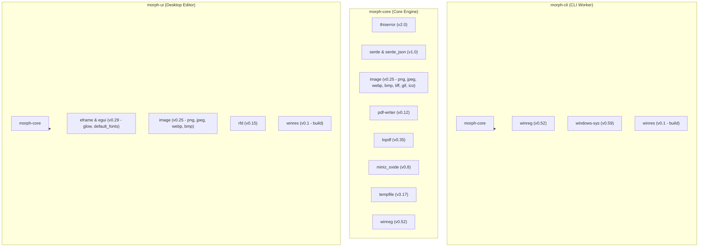

# 03: Frameworks, Libraries & Dependencies

This document provides a comprehensive technical audit of every external framework, crate, and runtime dependency powering **Morph**. For each dependency, we analyze its conceptual mechanics, integration points across the repository, consequences of removal, and potential architectural alternatives.

---

## 1. Complete Dependency Manifest & Workspace Matrix

---

## 2. In-Depth Dependency Analysis

### 1. `egui` and `eframe` (v0.29)
- **Role**: Native Immediate-Mode Graphical User Interface and Application Shell.
- **Why Needed**: Morph requires a graphical editor with sub-50ms startup latency and a memory footprint under 40 MB. Traditional retained-mode frameworks (Qt, WPF, GTK) or web-based shells (Electron, Tauri) introduce heavy runtimes, background threads, and massive binary footprints.
- **Internal Mechanics**:
  - `egui` operates on the **Immediate Mode** paradigm: the entire UI is redrawn every frame based on pure application state. There are no persistent widget trees, DOM nodes, or state synchronization bugs.
  - `eframe` (egui framework) handles window creation via `winit` and graphics context creation via `glow` (OpenGL ES bindings). Vertices generated by `egui` are batched into vertex and index buffers and dispatched directly to the GPU via OpenGL shaders.
- **Used In**:
  - [`crates/morph-ui/src/main.rs`](file:///c:/Morph/crates/morph-ui/src/main.rs): Application event loop (`eframe::App`), window viewport sizing, and keyboard shortcut binding.
  - [`crates/morph-ui/src/views/*`](file:///c:/Morph/crates/morph-ui/src/views): Panel layouts (`TopBottomPanel`, `SidePanel`, `CentralPanel`), custom scroll areas.
  - [`crates/morph-ui/src/components/*`](file:///c:/Morph/crates/morph-ui/src/components): Vector widgets and overlays.
- **If Removed**: The graphical editor `morph-ui.exe` could not exist. Morph would be reduced to a headless CLI utility.
- **Alternatives**:
  - *Tauri*: Lightweight webview wrapper, but introduces web-runtime dependencies, HTML/JS serialization overhead, and higher RAM consumption (~70–120MB).
  - *Slint*: High-performance native GUI toolkit, but has a smaller open-source ecosystem and complex dual-language DSL markup.
  - *Iced*: Retained-mode Elm-architecture framework for Rust, but heavier boilerplate for rapid visual tooling.

---

### 2. `lopdf` (v0.35)
- **Role**: Structural PDF Object Graph Parser, AST Manipulator, and Serializer.
- **Why Needed**: Modifying PDF documents (reordering pages, rotating pages, deleting pages, merging multiple documents) must preserve vector graphics, fonts, text, and embedded annotations without rasterizing pages to lossy bitmaps.
- **Internal Mechanics**:
  - `lopdf` models a PDF file as a directed object graph. It parses the PDF Cross-Reference Table (`xref`), object streams, and dictionary structures into Rust `Object` enums (`Integer`, `String`, `Name`, `Array`, `Dictionary`, `Stream`, `Reference`).
  - To merge documents, Morph loads individual documents, executes `doc.renumber_objects_with(max_id)` to prevent ID collision across independent files, merges their object tables into a single document, builds a unified `/Pages` catalog tree, and writes the output.
- **Used In**:
  - [`crates/morph-core/src/engines/pdf.rs`](file:///c:/Morph/crates/morph-core/src/engines/pdf.rs): `merge_pdfs`, `rotate_pages`, `delete_pages`, `reorder_pages`, `page_count`, `extract_page_text`.
- **If Removed**: PDF structural operations would be impossible without wrapping heavy external native binaries (e.g., `qpdf` or `poppler`).
- **Alternatives**:
  - *qpdf*: C++ command-line library. Requires bundling large dynamic link libraries (`.dll`) and complex C FFI bindings.
  - *pdfium-render*: Google's PDFium C++ engine. Excellent rendering capabilities, but heavy binary size (~15MB DLL).

---

### 3. `pdf-writer` (v0.12)
- **Role**: High-Speed, Zero-Allocation Streaming PDF Writer.
- **Why Needed**: Converting images (PNG, JPEG, WebP) into PDF pages requires constructing compliant PDF binary structures from scratch. While `lopdf` is designed for reading and mutating existing PDFs, `pdf-writer` is optimized for high-speed linear serialization with zero parsing overhead.
- **Internal Mechanics**:
  - `pdf-writer` writes PDF tokens directly into an internal byte buffer.
  - When embedding an image, it allocates an `/XObject` dictionary with subtype `/Image`, specifies color space (`/DeviceRGB` or `/DeviceGray`), configures compression filters (`/DctDecode` or `/FlateDecode`), and links an `/SMask` soft mask for alpha transparency.
- **Used In**:
  - [`crates/morph-core/src/engines/image.rs`](file:///c:/Morph/crates/morph-core/src/engines/image.rs): `images_to_pdf`.
- **If Removed**: Converting images to PDF would require manual PDF dictionary formatting or using `lopdf` with higher memory allocation overhead.
- **Alternatives**:
  - *printpdf*: High-level PDF generation library in Rust. Has larger dependency tree and slower compilation times.

---

### 4. `image` (v0.25)
- **Role**: Pure-Rust Image Decoding, Resampling, and Encoding.
- **Why Needed**: Morph supports cross-format image conversions (PNG, JPEG, WebP, BMP, TIFF, GIF, ICO), thumbnail generation, aspect-ratio calculations, and alpha-channel flattening.
- **Internal Mechanics**:
  - Decodes binary streams into a generic `DynamicImage` holding pixel buffers (`RgbImage`, `RgbaImage`).
  - In `morph-core`, default features are disabled to minimize binary bloat; only target codecs (`png`, `jpeg`, `webp`, `bmp`, `tiff`, `gif`, `ico`) are enabled in `Cargo.toml`.
  - Employs Lanczos3 filtering for downscaling and custom color calculations for alpha blending:
    $$\text{Channel}_{\text{final}} = \text{Pixel}_{\text{color}} \times \alpha + 255.0 \times (1.0 - \alpha)$$
- **Used In**:
  - [`crates/morph-core/src/engines/image.rs`](file:///c:/Morph/crates/morph-core/src/engines/image.rs): Image format conversion, ICO resizing, and alpha channel flattening.
  - [`crates/morph-ui/src/state/mod.rs`](file:///c:/Morph/crates/morph-ui/src/state/mod.rs): Background thread thumbnail generation (`img.thumbnail(320, 440)`).
  - [`crates/morph-ui/src/main.rs`](file:///c:/Morph/crates/morph-ui/src/main.rs): Decodes embedded `logo_fluent.png` into window viewport icon.
- **If Removed**: Raster image conversions, image thumbnailing, and texture decoding would cease to function.
- **Alternatives**:
  - *stb_image* (C bindings): Fast, but lacks safety guarantees and WebP/TIFF writing support.
  - *image-rs* ecosystem standalone crates (`png`, `zune-jpeg`, `image-webp`): Used directly by `image`.

---

### 5. `miniz_oxide` (v0.8)
- **Role**: Pure-Rust DEFLATE and ZLIB Compression / Decompression.
- **Why Needed**: Embedding uncompressed RGB raw bitmaps and alpha transparency masks into PDF `/FlateDecode` streams requires zlib-compatible DEFLATE compression.
- **Internal Mechanics**:
  - A 100% safe Rust port of the classic `miniz` C library. It operates without dynamic C runtime bindings (`zlib.dll`) and achieves compression speeds rivaling C implementations.
- **Used In**:
  - [`crates/morph-core/src/engines/image.rs`](file:///c:/Morph/crates/morph-core/src/engines/image.rs): `miniz_oxide::deflate::compress_to_vec_zlib(&p.raw_rgb, 6)`.
- **If Removed**: Compressed PDF `/FlateDecode` streams could not be created; PDFs generated from PNGs would be 10x–20x larger.
- **Alternatives**:
  - *flate2*: A higher-level wrapper around `miniz_oxide` or C `libz`.

---

### 6. `winreg` (v0.52)
- **Role**: High-Level Rust Wrapper for the Windows Registry API.
- **Why Needed**: Registering File Explorer context menu verbs, detecting Microsoft Word installation paths, and querying file associations requires accessing `HKEY_CURRENT_USER` and `HKEY_LOCAL_MACHINE`.
- **Internal Mechanics**:
  - Wraps Win32 APIs: `RegCreateKeyExW`, `RegSetValueExW`, `RegDeleteTreeW`, `RegOpenKeyExW`.
  - Converts Rust strings to null-terminated UTF-16 wide strings (`LPCWSTR`) expected by the Windows kernel.
- **Used In**:
  - [`crates/morph-cli/src/windows/context_menu.rs`](file:///c:/Morph/crates/morph-cli/src/windows/context_menu.rs): Registers and unregisters cascading verbs under `HKCU\Software\Classes\SystemFileAssociations`.
  - [`crates/morph-core/src/engines/document.rs`](file:///c:/Morph/crates/morph-core/src/engines/document.rs): Queries `HKLM\SOFTWARE\Microsoft\Windows\CurrentVersion\App Paths\winword.exe` to verify Microsoft Word presence.
- **If Removed**: Context menu installation would require manual `.reg` files or raw unsafe Win32 FFI calls.

---

### 7. `windows-sys` (v0.59)
- **Role**: Zero-Overhead Direct Windows SDK FFI Bindings.
- **Why Needed**: Calling specific Win32 console functions (`AttachConsole`) without the massive compile-time overhead of the full `windows` crate.
- **Internal Mechanics**:
  - Provides raw `extern "system"` signatures and constants generated directly from Windows SDK metadata (`win32metadata`).
  - Feature-gated: only links `Win32_System_Console`, `Win32_Storage_FileSystem`, and `Win32_Foundation`.
- **Used In**:
  - [`crates/morph-cli/src/main.rs`](file:///c:/Morph/crates/morph-cli/src/main.rs#L78): Calls `AttachConsole(ATTACH_PARENT_PROCESS)`.
- **If Removed**: The CLI would have to write manual `extern "system"` function signatures.
- **Alternatives**:
  - *windows* crate: Official Microsoft crate, but has significantly larger compile times and dependency graphs.
  - *winapi*: Older legacy crate, largely superseded by `windows-sys`.

---

### 8. `rfd` (v0.15 - Rust File Dialog)
- **Role**: Native Windows File Open and Save Dialog Wrapper.
- **Why Needed**: Prompting the user to select files or choose an export destination in `morph-ui`.
- **Internal Mechanics**:
  - Invokes the modern Windows Shell COM interface `IFileDialog` (`CLSID_FileOpenDialog` / `CLSID_FileSaveDialog`).
  - Respects Windows 10/11 visual styling, quick access bookmarks, and high-DPI scaling.
- **Used In**:
  - [`crates/morph-ui/src/main.rs`](file:///c:/Morph/crates/morph-ui/src/main.rs#L478): Save file dialog for exporting assembled PDFs.
  - [`crates/morph-ui/src/views/empty_state.rs`](file:///c:/Morph/crates/morph-ui/src/views/empty_state.rs#L81): File picker button.
- **If Removed**: Morph UI would require a custom file browser UI widget.

---

### 9. `thiserror` (v2.0)
- **Role**: Declarative Derive Macro for Custom Error Types.
- **Why Needed**: Provides clean, user-friendly error formatting and automated `From<std::io::Error>` implementations.
- **Used In**:
  - [`crates/morph-core/src/error.rs`](file:///c:/Morph/crates/morph-core/src/error.rs): `#[derive(Error, Debug)] pub enum MorphError`.

---

### 10. `winres` (v0.1)
- **Role**: Build-Time Windows Resource Compiler Integration.
- **Why Needed**: Compiles `assets/logo.ico` into an `.rc` file and invokes MSVC `rc.exe` to embed the application icon into the PE header of `morph.exe` and `morph-ui.exe`.
- **Used In**:
  - [`crates/morph-cli/build.rs`](file:///c:/Morph/crates/morph-cli/build.rs) and [`crates/morph-ui/build.rs`](file:///c:/Morph/crates/morph-ui/build.rs).
- **If Removed**: Executables in File Explorer would display the generic blank white window icon.

---

## 3. Comparative Dependency Matrix

| Crate | Binary Footprint Impact | Primary Alternatives | Why Selected Over Alternatives |
| :--- | :--- | :--- | :--- |
| **`eframe` / `egui`** | ~4.5 MB | Tauri, Qt, Slint, WPF | Sub-50ms startup, <40MB RAM, pure Rust, no webview |
| **`lopdf`** | ~1.2 MB | qpdf, pdfium | Direct vector AST manipulation in safe Rust |
| **`pdf-writer`** | ~0.4 MB | printpdf | Minimal memory allocation, high-speed streaming |
| **`image`** | ~2.1 MB | stb_image | Comprehensive format support, pure Rust safety |
| **`winreg`** | ~0.1 MB | Manual Win32 FFI | Safe, idiomatic Rust API for Windows registry |
| **`windows-sys`** | ~0.1 MB | `windows`, `winapi` | Minimal compile times, exact feature gating |
| **`rfd`** | ~0.3 MB | Native Win32 COM calls | Modern `IFileDialog` support with clean API |
| **`miniz_oxide`** | ~0.2 MB | `libz-sys` | Pure Rust, zero C toolchain requirement |

