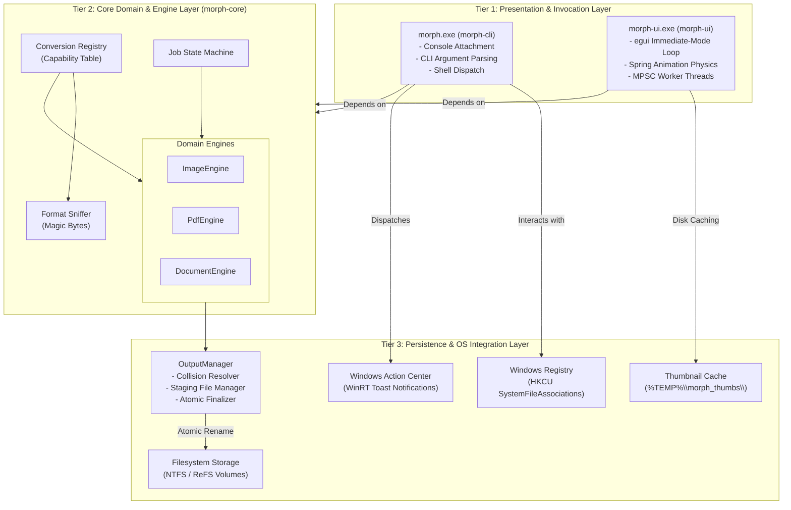
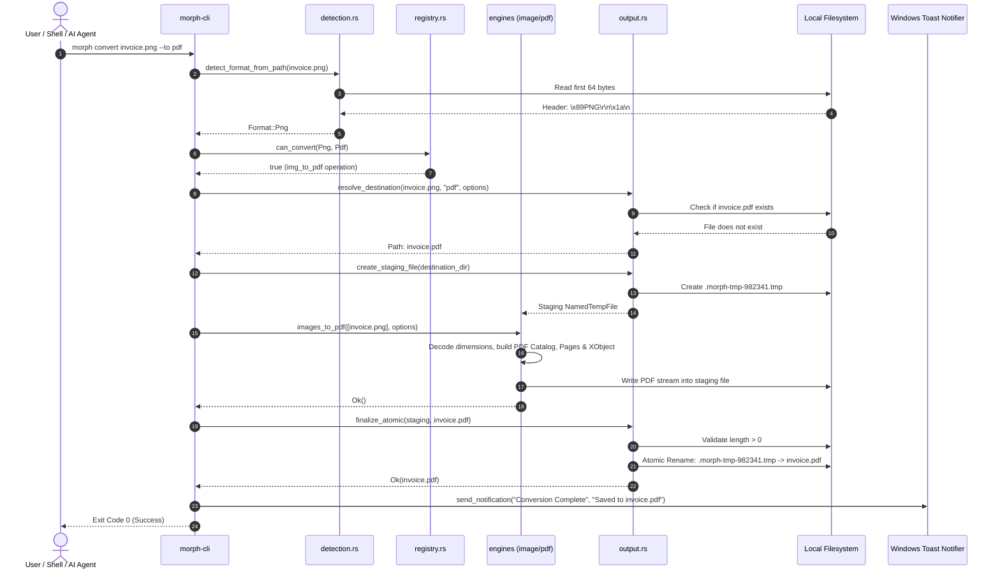
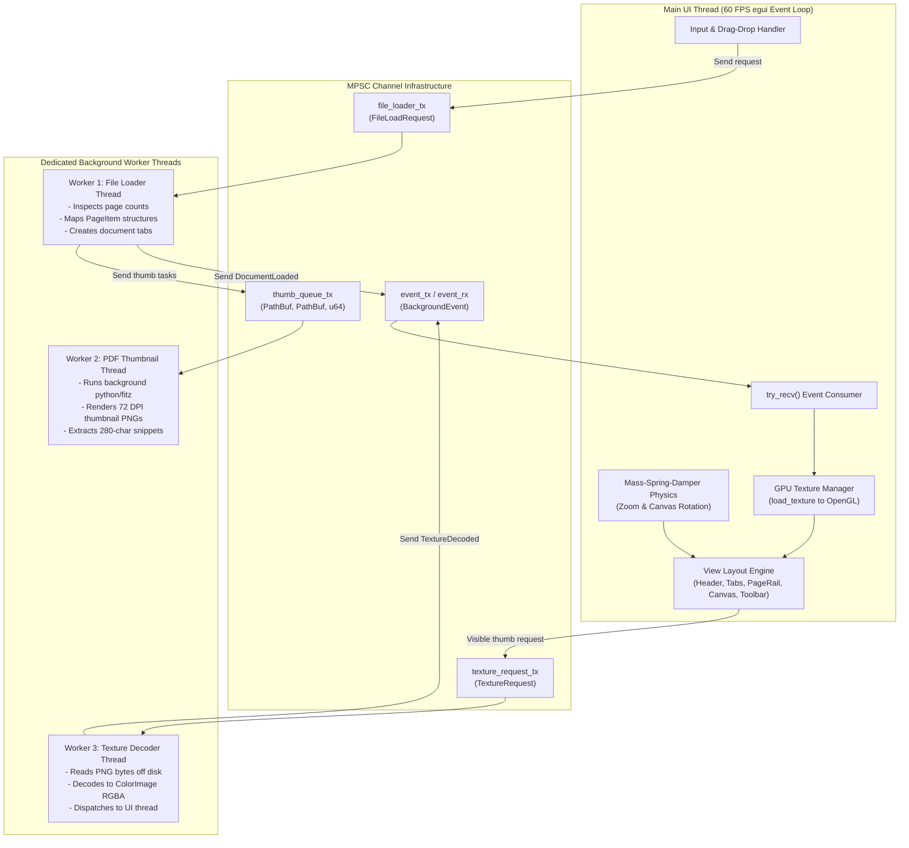

# 04: System Architecture & Design Patterns

This chapter details the overarching system architecture of **Morph**. It explains the structural patterns, layer responsibilities, data flow, component boundaries, and internal communication mechanisms that govern the codebase.

---

## 1. Architectural Pattern: Decoupled Multi-Tier Architecture

Morph is structured around a **Decoupled Multi-Tier Architecture** that enforces a strict unidirectional dependency flow:

### Architectural Principles Governing This Structure
1. **Engine Independence**: `morph-core` has zero knowledge of `morph-cli` or `morph-ui`. It can be imported by any Rust binary, compiled as a C-compatible dynamic library (`cdylib`), or integrated into a web service.
2. **Headless Execution**: All business logic (format sniffing, PDF tree manipulation, image filtering) executes without initializing a window or graphics context.
3. **No Circular Dependencies**: Dependencies flow strictly downward. Tier 1 depends on Tier 2; Tier 2 depends on standard libraries and OS primitives. Tier 2 never calls back into Tier 1.

---

## 2. Layer Responsibilities & Component Details

### Layer 1: Presentation & Invocation Layer
- **`morph-cli`**:
  - Handles process bootstrapping.
  - Dynamically binds to parent console via `AttachConsole`.
  - Parses command-line tokens (`convert`, `merge`, `pdf rotate`, `pdf delete`, `register`, `unregister`, `status`).
  - Routes complex multi-file visual edit requests to `morph-ui.exe`.
  - Dispatches non-blocking WinRT Toast Notifications on job completion or failure.
- **`morph-ui`**:
  - Runs an immediate-mode 60 FPS graphics loop via `eframe` and hardware OpenGL (`glow`).
  - Implements physics-based mass-spring-damper animations for zoom levels and canvas rotation.
  - Manages multi-document tab state, undo/redo history stacks, and drag-and-drop overlays.
  - Coordinates three dedicated background threads via MPSC channels to keep the UI completely non-blocking.

### Layer 2: Core Domain & Engine Layer (`morph-core`)
- **`detection`**:
  - Validates input files by reading the initial 64 bytes (magic headers).
  - Distinguishes between true file formats and deceptive or misnamed extensions.
- **`registry`**:
  - Maintains a catalog of available conversion capabilities (`ConversionOperation`).
  - Exposes query methods: `find_instant_operations`, `find_editor_operations`, `can_convert`.
- **`engines::image`**:
  - Manages cross-format raster encoding/decoding via `image`.
  - Implements single-pass JPEG embedding into PDF `/XObject` streams via `/DctDecode`.
  - Splits RGBA images into raw RGB streams and separate 8-bit alpha soft masks (`/SMask`) with zlib compression.
- **`engines::pdf`**:
  - Manipulates PDF object trees directly via `lopdf`.
  - Renumbers object IDs dynamically to merge disparate PDF documents into a unified object catalog.
  - Modifies page `/Rotate` dictionary attributes losslessly ($90^\circ, 180^\circ, 270^\circ$).
  - Re-indexes `/Kids` and `/Count` arrays in the parent `/Pages` tree for page deletion and reordering.
  - Assembles unified documents from mixed arrays of `PageSpec` (PDF pages + images).
- **`engines::document`**:
  - Bridges office document formats (DOCX, DOC, ODT, RTF) to PDF using local Microsoft Word COM automation or headless LibreOffice.

### Layer 3: Persistence & OS Integration Layer
- **`output::OutputManager`**:
  - Resolves non-colliding destination paths (`filename (1).ext`).
  - Creates hidden sibling staging files (`.morph-tmp-XXXX`).
  - Performs atomic finalization using OS filesystem rename primitives.
  - Validates output integrity (nonzero byte lengths).

---

## 3. Data Flow Architecture

The diagram below tracks the complete lifecycle of a file conversion request:

---

## 4. UI Architecture & Asynchronous Worker Pipeline

`morph-ui` implements an **Asynchronous Multi-Threaded Reactive Pipeline**. The UI thread never blocks on disk I/O, PDF rendering, or image decoding:

### The 4-Tier GPU Texture Pipeline
To guarantee that rotating pages executes at a fluid 60 FPS without disk latency or white flickering, `morph-ui` utilizes a 4-tier texture fallback mechanism:
1. **Tier 1 (Dedicated Rotated Thumbnail)**: If a thumbnail rendered at the target rotation angle exists in cache, paint it directly.
2. **Tier 2 (Dedicated Rotated Preview)**: If a high-res preview at the target rotation angle exists, paint it directly.
3. **Tier 3 (Base Unrotated Thumbnail with GPU Vertex Rotation)**: If only the unrotated thumbnail is in memory, apply a hardware rotation transform (`egui::Image::rotate`) in the vertex shader.
4. **Tier 4 (Base Preview with GPU Vertex Rotation)**: Fall back to rotating the high-res unrotated texture on the GPU.

This guarantees that rotating a document never displays a blank card.

---

## 5. Security & Boundary Architecture

| Boundary | Mechanism | Verification / Guarantee |
| :--- | :--- | :--- |
| **Network Boundary** | Zero socket calls | The codebase contains zero HTTP, TCP, or UDP imports. Fully air-gapped. |
| **Filesystem Boundary** | Sibling staging files | Temporary files are created strictly in the target destination's parent folder, guaranteeing same-volume atomic renames without cross-drive copy delays. |
| **Execution Boundary** | HKCU Shell Verbs | Context menu registration occurs strictly in `HKEY_CURRENT_USER`, ensuring unprivileged operation without administrative UAC triggers. |
| **Process Isolation** | `CREATE_NO_WINDOW` | Subprocess invocations (PowerShell for toasts, Python for thumbnails, Word COM) enforce the `0x08000000` creation flag, preventing background console window flashes. |

