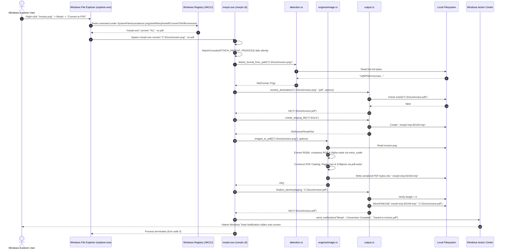
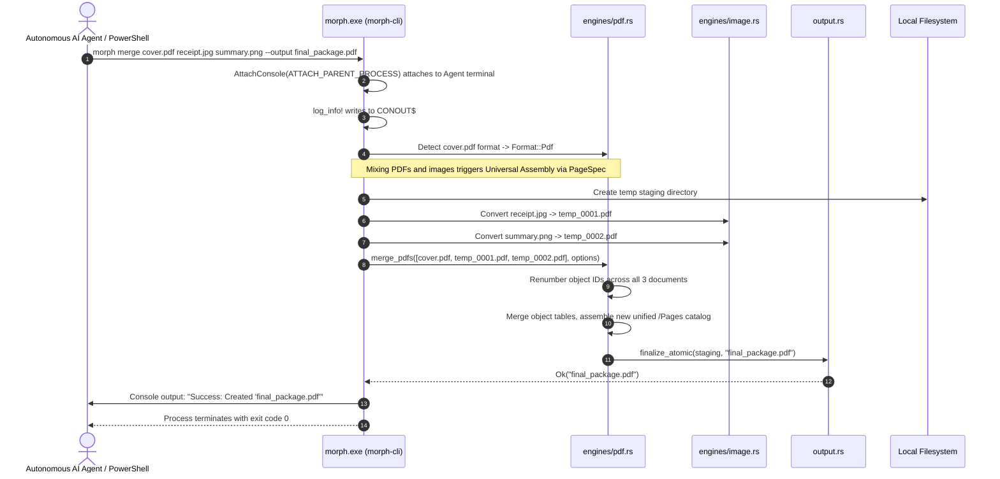
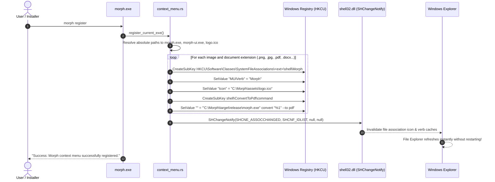
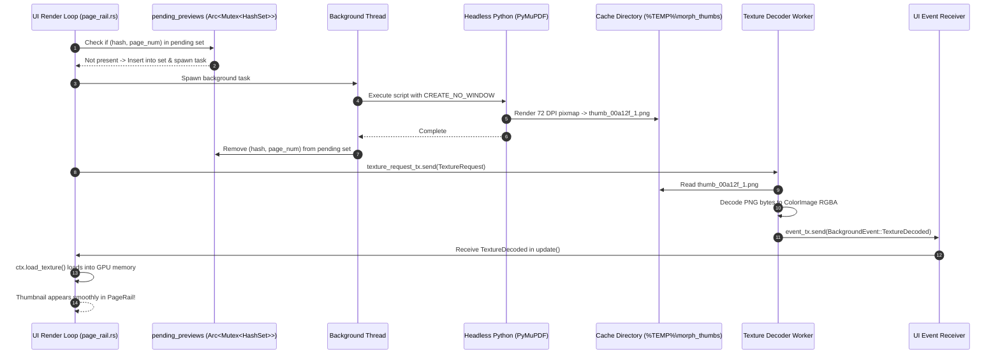

# 08: End-to-End Execution Flows & Sequence Traces

This chapter traces five critical end-to-end workflows in **Morph**, mapping every step from user trigger to final operating system output.

---

## 1. Flow 1: Context Menu Instant Conversion

This flow traces what happens when a user right-clicks `invoice.png` in Windows File Explorer and selects **Morph $\rightarrow$ Convert to PDF**:



---

## 2. Flow 2: Multi-File CLI Merge Command

This flow traces an AI coding agent or automation script executing a multi-format merge command:
```powershell
morph merge cover.pdf receipt.jpg summary.png --output final_package.pdf
```



---

## 3. Flow 3: Interactive Editor File Drag-and-Drop & GPU Rotation

This flow traces what happens inside the desktop editor (`morph-ui.exe`) when a user drags a file into the window and rotates a page:

```mermaid
sequenceDiagram
    autonumber
    actor User as User
    participant Viewport as egui Viewport
    participant App as MorphApp (UI Thread)
    participant MPSC as File Loader Channel
    participant Worker as Background File Worker
    participant GPU as Hardware GPU (OpenGL)

    User->>Viewport: Drag "contract.pdf" over Morph Editor window
    Viewport->>App: ctx.input().raw.hovered_files populated
    App->>Viewport: render_dropzone_overlay(ctx, is_hovering=true)
    Viewport-->>User: Pulsing blue dropzone overlay appears

    User->>Viewport: Drop file into window
    Viewport->>App: ctx.input().raw.dropped_files received
    App->>MPSC: file_loader_tx.send(FileLoadRequest::OpenDocuments)
    Note over App: Main UI thread continues at 60 FPS; zero freeze!

    Worker->>MPSC: Read page count from contract.pdf (12 pages)
    Worker->>MPSC: Dispatch thumbnail requests to thumb_queue_tx
    Worker->>App: event_tx.send(BackgroundEvent::DocumentLoaded)

    App->>App: Add DocumentState to documents array
    App->>Viewport: Render DocumentTab & PageRail thumbnail cards

    User->>Viewport: Click "Rotate Clockwise" (R key)
    App->>App: page.rotation_degrees = (0 + 90) % 360 = 90
    App->>App: canvas_rotation_spring.set_target(90.0)
    App->>GPU: egui::Image::rotate(1.5708 rad) modifies vertex UV matrix
    GPU-->>User: Page rotates instantaneously at 60 FPS without disk read!
```

---

## 4. Flow 4: Context Menu Shell Registration

This flow traces executing `morph register` to configure Windows File Explorer:



---

## 5. Flow 5: Background Thumbnail Rendering & In-Flight Deduplication

This flow traces how thumbnail requests are deduplicated and processed asynchronously off the UI thread:



