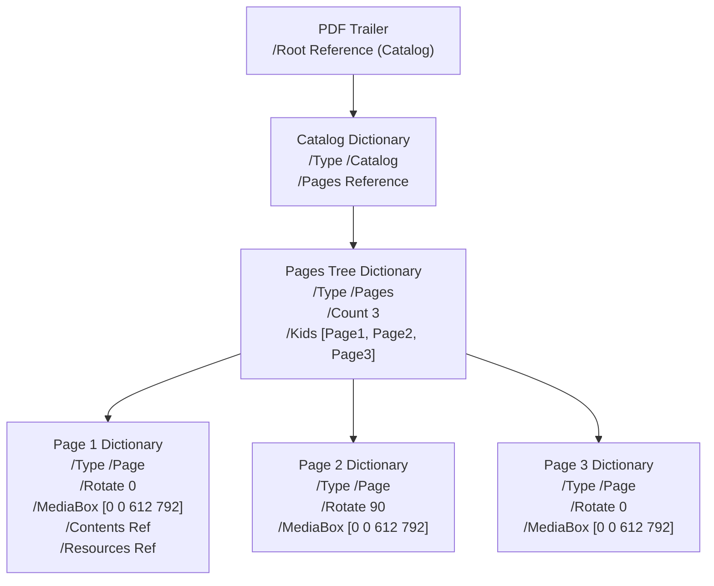
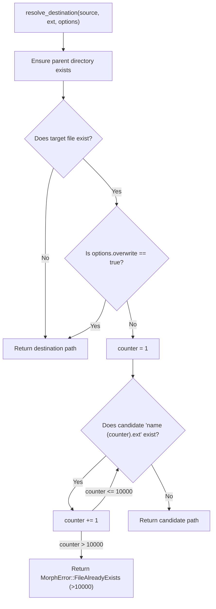

# 09: Data Management, PDF Graphs & Disk Caching

This chapter details how data is modeled, managed, cached, and persisted in **Morph**. Although Morph does not require an external relational database (such as PostgreSQL or SQLite), it manages three sophisticated data layers:
1. **The In-Memory Document State & Undo/Redo Engine** (`morph-ui::state`).
2. **The PDF Document Object Graph Database** (`lopdf` / `pdf-writer`).
3. **The Filesystem Staging & Cache Persistence Subsystem** (`output::OutputManager` and `%TEMP%\morph_thumbs\`).

---

## 1. The In-Memory Document State Architecture

Inside `morph-ui`, each open document is managed as an independent, isolated state container:

```rust
#[derive(Clone, Debug)]
pub struct DocumentState {
    pub id: usize,
    pub file_path: PathBuf,
    pub file_name: String,
    pub is_image: bool,
    pub pages: Vec<PageItem>,
    pub selected_page_index: Option<usize>,
    pub history: Vec<EditorHistory>,
    pub history_index: usize,
    pub zoom: f32,
    pub visual_rotation: f32,
    pub scroll_y: f32,
    pub next_page_id: usize,
}
```

### The Page Entity (`PageItem`)
Each individual page inside a document is tracked as a unique entity:
```rust
#[derive(Clone, Debug, PartialEq)]
pub struct PageItem {
    pub id: usize,                      // Global monotonic unique identifier
    pub original_page_num: u32,         // 1-based page index in the source file
    pub source_file: PathBuf,           // Absolute path to the original document
    pub rotation_degrees: i32,          // Cumulative user rotation (0, 90, 180, 270)
    pub is_image: bool,                 // Whether the source is a standalone image
    pub thumbnail_path: Option<PathBuf>,// Disk path to 72 DPI thumbnail PNG
    pub highres_path: Option<PathBuf>,  // Disk path to 180 DPI preview PNG
    pub text_snippet: Option<String>,   // 280-character plaintext preview
}
```

### The Transactional Undo/Redo Engine
Morph implements a **Snapshot State History Pattern**:
```rust
#[derive(Clone, Debug)]
pub struct EditorHistory {
    pub pages: Vec<PageItem>,
}
```
- **Recording Changes (`save_history`)**: Whenever a mutating operation occurs (rotating a page, deleting a page, duplicating a page, or reordering pages), Morph truncates any forward "redo" history (`self.history.truncate(self.history_index)`) and pushes a clone of the `pages` array to the history stack.
- **Undo Operation**: Decrements `self.history_index` and restores `self.pages` from `self.history[self.history_index - 1]`.
- **Redo Operation**: Increments `self.history_index` and restores `self.pages` from the forward snapshot.

---

## 2. The PDF Object Graph Database (`lopdf`)

A PDF file is not a flat linear document; it is an **indexed hierarchical object database** with a cross-reference table acting as an index:



### In-Memory Graph Manipulation
When `morph-core` mutates a PDF:
1. `Document::load(path)` parses the trailer, resolves the cross-reference table (`xref`), and inflates all objects into an in-memory `BTreeMap<(u32, u16), Object>`.
2. To delete a page, Morph deletes the page object from `doc.objects` and purges its reference from the parent `/Kids` array.
3. To rotate a page, Morph locates the `(object_id, generation)` pair for that page, retrieves its mutable dictionary, and updates the `/Rotate` key:
   ```rust
   page_dict.set("Rotate", Object::Integer(new_rot));
   ```
4. `doc.save(staging_path)` serializes the object graph into a compliant binary stream, recalculating byte offsets for every object in the cross-reference table.

---

## 3. Disk Cache Architecture (`%TEMP%\morph_thumbs\`)

To maintain instant thumbnail scrolling in documents with hundreds of pages, Morph implements a deterministic disk caching strategy:

### 1. Deterministic Path Hashing
To prevent filename collision across documents with the same name (e.g., `C:\Work\report.pdf` vs `D:\Archives\report.pdf`), Morph computes a 64-bit cryptographic hash of the absolute file path:
```rust
pub fn hash_path(path: &Path) -> u64 {
    use std::collections::hash_map::DefaultHasher;
    use std::hash::{Hash, Hasher};
    let mut s = DefaultHasher::new();
    path.to_string_lossy().hash(&mut s);
    s.finish()
}
```

### 2. Cache Key Namespaces
Files in `%TEMP%\morph_thumbs\` adhere to a strict naming grammar:
- **Thumbnails (72 DPI)**: `thumb_{path_hash:016x}_{page_num}.png`
- **High-Res Previews (180 DPI)**: `page_{path_hash:016x}_{page_num}.png`
- **Text Snippets**: `snip_{path_hash:016x}_{page_num}.txt`
- **Image Thumbnails**: `img_thumb_{path_hash:016x}.png`

### 3. Cache Lifecycle & Hygiene
- **On Application Startup**: Scans the cache folder and automatically deletes files whose last-modified timestamp exceeds 24 hours.
- **On Tab Close**: Spawns a background thread that scans `%TEMP%\morph_thumbs\` and immediately deletes all files beginning with the closed document's `path_hash` prefix.
- **On Application Exit (`on_exit`)**: Purges all remaining temporary session files.

---

## 4. Collision Resolution & Atomic Persistence

### The Safe Output Algorithm
In [`crates/morph-core/src/output.rs`](file:///c:/Morph/crates/morph-core/src/output.rs):



### The Atomic Finalization Primitive
To prevent truncated files from being created if an operation is interrupted or crashes:
1. Work is written to a hidden staging file: `.morph-tmp-XXXXXX.tmp`.
2. Staging file length is validated (`metadata.len() > 0`).
3. If destination exists and overwrite was permitted, the old destination is removed.
4. `staging.persist(destination)` triggers the operating system's atomic rename primitive (`MoveFileExW` with `MOVEFILE_REPLACE_EXISTING`).

