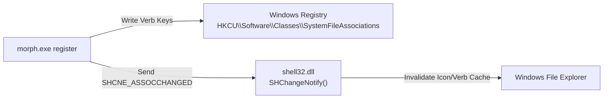

# 10: API & Communication Protocols

This document defines the external and internal communication protocols utilized by **Morph**. In a native desktop and systems programming utility, "API" comprises:
1. **The CLI Command Contract** (the public programmatic interface used by scripts and autonomous AI agents).
2. **The Windows Shell Integration Protocol** (registry verbs and shell notifications).
3. **Inter-Process Communication (IPC)** (Win32 COM automation and WinRT toast notifications).
4. **In-Process Multi-Threaded Channel Protocols** (MPSC messaging between UI and background workers).

---

## 1. The Autonomous AI Agent & CLI Command Contract

The CLI (`morph.exe`) exposes a deterministic, machine-readable command-line interface.

### Exit Code Specifications
- **`0`**: Command succeeded completely. The generated output file is fully finalized on disk.
- **`1`**: Command failed. An error message has been logged to `stderr` / `CONOUT$`. No partial or corrupted files remain on disk.

---

### Command Specifications

#### 1. `morph convert <file> --to <format> [options]`
Converts a single input file into a target format.

- **Arguments**:
  - `<file>`: Source file path (supports Unicode, relative paths, absolute paths, and paths with spaces).
- **Options**:
  - `--to <format>` *(Required)*: Target format extension (`pdf`, `png`, `jpg`, `webp`, `bmp`, `tiff`).
  - `--quality <1-100>` *(Optional, default: 85)*: Lossy compression quality for JPEG/WebP.
  - `--output <path>` *(Optional)*: Custom destination directory or filename.
  - `--overwrite` *(Optional)*: Overwrite destination file if it already exists.
  - `--no-notify` *(Optional)*: Suppress Windows Action Center toast notifications.

**Example Request & Response**:
```powershell
morph convert "C:\Finance\Q3 Report.docx" --to pdf
```
```
Converting 'C:\Finance\Q3 Report.docx' (DOCX) -> PDF...
Success: Generated 'C:\Finance\Q3 Report.pdf'
```

---

#### 2. `morph merge <files...> [--output <path>] [options]`
Combines multiple files (PDFs, images, or mixed) into a single PDF.

- **Arguments**:
  - `<files...>`: Space-separated list of two or more input paths.
- **Options**:
  - `--output <path>` *(Optional)*: Destination path (defaults to `{first_input_stem}.pdf`).
  - `--overwrite` *(Optional)*: Overwrite destination.
  - `--no-notify` *(Optional)*: Suppress toasts.

**Example Request & Response**:
```powershell
morph merge page1.pdf scan.jpg notes.png --output "full_dossier.pdf"
```
```
Merging 3 files into PDF...
Success: Created 'C:\Workspace\full_dossier.pdf'
```

---

#### 3. `morph pdf rotate <file> --degrees <90|180|270> [--pages <1,2,...>]`
Rotates specific pages or all pages of a PDF document losslessly without rasterization.

- **Arguments**:
  - `<file>`: Path to PDF.
- **Options**:
  - `--degrees <90|180|270>` *(Required)*: Rotation angle clockwise.
  - `--pages <1,2,...>` *(Optional)*: Comma-delimited list of 1-based page numbers. If omitted, rotates all pages.

**Example Request & Response**:
```powershell
morph pdf rotate architectural_plan.pdf --degrees 90 --pages 1,3
```
```
Success: Rotated PDF saved as 'C:\Workspace\architectural_plan (1).pdf'
```

---

#### 4. `morph pdf delete <file> --pages <1,2,...>`
Deletes specific pages from a PDF.

- **Arguments**:
  - `<file>`: Path to PDF.
- **Options**:
  - `--pages <1,2,...>` *(Required)*: Comma-delimited list of 1-based page numbers to remove.

---

#### 5. `morph register` / `morph unregister` / `morph status`
- `register`: Registers per-user cascading context menus into Windows File Explorer.
- `unregister`: Completely purges all Morph registry keys from `HKCU`.
- `status`: Outputs engine version, offline capability status, context menu registration state, and all supported conversion operations.

---

## 2. Windows Shell Integration Protocol

Morph communicates with the Windows Explorer shell via registry verbs and shell change notifications:



### Registry Key Architecture
Under `HKEY_CURRENT_USER\Software\Classes\SystemFileAssociations\<extension>\shell\Morph`:
- `MUIVerb`: `"Morph"` (The top-level menu label).
- `SubCommands`: `""` (Tells Windows Explorer to render this item as a cascading flyout submenu).
- `Icon`: `"C:\Morph\assets\logo.ico"` (The embedded brand icon).
- Subkey `shell\ConvertToPdf\command`: `"C:\Morph\target\release\morph.exe" convert "%1" --to pdf`.
- Subkey `shell\OpenEditor\command`: `"C:\Morph\target\release\morph-ui.exe" "%1"`.

### Shell Change Notification (`SHChangeNotify`)
In [`crates/morph-cli/src/windows/context_menu.rs`](file:///c:/Morph/crates/morph-cli/src/windows/context_menu.rs#L167-L182):
```rust
#[cfg(windows)]
unsafe {
    #[link(name = "shell32")]
    extern "system" {
        fn SHChangeNotify(
            w_event_id: i32,
            u_flags: u32,
            dw_item1: *const std::ffi::c_void,
            dw_item2: *const std::ffi::c_void,
        );
    }
    // SHCNE_ASSOCCHANGED = 0x08000000, SHCNF_IDLIST = 0
    SHChangeNotify(0x08000000, 0, std::ptr::null(), std::ptr::null());
}
```
This forces Windows Explorer to immediately reload its context menu cache without logging off or restarting the machine.

---

## 3. Inter-Process Communication (IPC)

### 1. WinRT Toast Notification Protocol
To notify users without opening disruptive popup windows, Morph dispatches notifications via the Windows Action Center:
```powershell
[Windows.UI.Notifications.ToastNotificationManager, Windows.UI.Notifications, ContentType = WindowsRuntime] | Out-Null;
$template = [Windows.UI.Notifications.ToastTemplateType]::ToastText02;
$xml = [Windows.UI.Notifications.ToastNotificationManager]::GetTemplateContent($template);
$textNodes = $xml.GetElementsByTagName('text');
$textNodes.Item(0).AppendChild($xml.CreateTextNode("Morph - Conversion Complete")) | Out-Null;
$textNodes.Item(1).AppendChild($xml.CreateTextNode("Saved to invoice.pdf")) | Out-Null;
$toast = [Windows.UI.Notifications.ToastNotification]::new($xml);
$notifier = [Windows.UI.Notifications.ToastNotificationManager]::CreateToastNotifier('Morph');
$notifier.Show($toast);
```
- Executed by spawning a hidden background PowerShell instance (`CREATE_NO_WINDOW = 0x08000000`).
- Does not block the CLI worker from returning immediately.

### 2. Microsoft Word COM Automation Protocol
In [`crates/morph-core/src/engines/document.rs`](file:///c:/Morph/crates/morph-core/src/engines/document.rs#L141-L157):
- Instantiates the Component Object Model (COM) class `Word.Application` (`CLSID {000209FF-0000-0000-C000-000000000046}`).
- Opens the document silently: `$word.Visible = $false; $word.DisplayAlerts = 0;`.
- Calls `$doc.ExportAsFixedFormat('{out_str}', 17)` (format code `17` = PDF).
- Closes the document and calls `Marshal.ReleaseComObject($word)` in a `finally` block to release COM runtime locks.

---

## 4. In-Process Multi-Threaded Messaging Protocols (MPSC)

Within `morph-ui`, threads communicate via strongly-typed Rust enums over standard `mpsc` channels:

### Requests Dispatched to Background Workers
```rust
pub enum FileLoadRequest {
    OpenDocuments {
        files: Vec<PathBuf>,
        start_doc_id: usize,
        start_page_id: usize,
        cache_dir: PathBuf,
    },
    InsertPages {
        doc_id: usize,
        files: Vec<PathBuf>,
        insert_index: usize,
        start_page_id: usize,
        cache_dir: PathBuf,
    },
}

pub struct TextureRequest {
    pub id: usize,
    pub path: PathBuf,
    pub is_preview: bool,
}
```

### Events Received by the UI Event Loop
```rust
pub enum BackgroundEvent {
    DocumentLoaded {
        doc_id: usize,
        file_path: PathBuf,
        is_image: bool,
        pages: Vec<PageItem>,
    },
    PagesInserted {
        doc_id: usize,
        insert_index: usize,
        pages: Vec<PageItem>,
    },
    TextureDecoded {
        id: usize,
        is_preview: bool,
        image: egui::ColorImage,
    },
    SnippetLoaded {
        id: usize,
        text: String,
    },
}
```
All messages are processed asynchronously in `update()` via non-blocking `try_recv()`.

