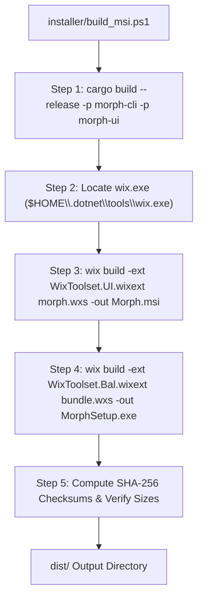

# 11: Configuration, Build Pipelines & Deployment

This chapter provides complete documentation on how **Morph** is configured, compiled, packaged, and distributed across Windows operating systems.

---

## 1. Prerequisites & Environment Setup

Building Morph from source requires the following toolchain components:

| Component | Minimum Version | Recommended Version | Purpose |
| :--- | :--- | :--- | :--- |
| **Rust Toolchain** | 1.80.0 Stable | 1.85.0+ (`stable-x86_64-pc-windows-msvc`) | Rust compiler (`rustc`), package manager (`cargo`) |
| **Visual Studio Build Tools** | 2019 (v142) | 2022 (v143) C++ x64/x86 Build Tools | MSVC Linker (`link.exe`), Resource Compiler (`rc.exe`) |
| **Windows SDK** | 10.0.19041.0 | 10.0.22621.0 (Windows 11 SDK) | Win32 headers, PE subsystem libraries |
| **WiX Toolset** | 4.0.0 | 4.0.6 (`dotnet tool install --global wix`) | Compiling MSI and Bootstrapper EXE packages |
| **Inno Setup** *(Optional)* | 6.0 | 6.3.0 (`ISCC.exe`) | Compiling alternative single-file standalone installer |
| **Python** *(Optional)* | 3.9+ | 3.11+ with `pymupdf` (`pip install fitz`) | High-speed PDF thumbnail rendering helper |

---

## 2. Compilation & Cargo Workspace Pipeline

### Step 1: Building Release Binaries
To compile fully optimized, stripped native release binaries across the entire workspace:
```powershell
# Navigate to repository root
cd C:\Morph

# Build both binaries in release mode
cargo build --release --workspace
```

### What Happens During Build:
1. **Workspace Resolution**: Cargo reads `C:\Morph\Cargo.toml` and activates workspace members `crates/morph-core`, `crates/morph-cli`, and `crates/morph-ui`.
2. **Build Scripts Execution (`build.rs`)**:
   - `crates/morph-cli/build.rs` and `crates/morph-ui/build.rs` execute on the host machine.
   - `winres` invokes the MSVC resource compiler (`rc.exe`) to compile `assets/logo.ico` into an object resource file (`resource.res`).
3. **Compilation & Linkage**:
   - `rustc` compiles source files into native object files.
   - `link.exe` links MSVC runtime libraries and embeds `resource.res` directly into the PE headers.
4. **Artifact Generation**:
   - `target\release\morph.exe` (CLI and Context Menu Worker, ~3.8 MB).
   - `target\release\morph-ui.exe` (Desktop Editor, ~8.2 MB).

---

## 3. Installer Packaging Automation (`installer/build_msi.ps1`)

Morph includes an automated PowerShell script that builds both a standard Windows Installer (`.msi`) and a single-file bootstrapper executable (`.exe`):



### Executing the Build Script:
```powershell
powershell -ExecutionPolicy Bypass -File .\installer\build_msi.ps1
```

### Script Output:
```
========================================================
 Installer Release Packages Built Successfully!
 1. MSI Installer: C:\Morph\dist\Morph-v0.1.0-windows-x64.msi (5.01 MB)
    SHA-256:       E142F85C77...
 2. Setup EXE:     C:\Morph\dist\MorphSetup-v0.1.0-windows-x64.exe (6.03 MB) [With Logo Icon]
    SHA-256:       A899C2B104...
========================================================
```

---

## 4. WiX v4 Package Architecture (`installer/morph.wxs`)

The WiX manifest configures a modern, per-user Windows Installer package:

### 1. Per-User Scope (Zero Administrator Rights Required)
```xml
<Package Name="Morph"
         Manufacturer="Morph Open Source"
         Version="0.1.0"
         UpgradeCode="E68F8425-46D9-4FE7-9F9C-B3061C8B4907"
         Scope="perUser">
```
`Scope="perUser"` instructs Windows Installer to install files into `%LocalAppData%\Programs\Morph`. This enables installation on locked-down enterprise machines without UAC elevation.

### 2. User Environment PATH Injection
```xml
<Environment Id="UserPathEnv"
             Name="PATH"
             Value="[INSTALLFOLDER]"
             Permanent="no"
             Part="last"
             Action="set"
             System="no" />
```
Adds `%LocalAppData%\Programs\Morph` to the user's personal `PATH` environment variable, enabling AI agents and terminals to invoke `morph` globally.

### 3. Automated Context Menu Lifecycle Hooks
```xml
<CustomAction Id="RegisterContextMenu"
              FileRef="MorphCliExe"
              ExeCommand="register"
              Execute="deferred"
              Impersonate="yes"
              Return="ignore" />

<CustomAction Id="UnregisterContextMenu"
              FileRef="MorphCliExe"
              ExeCommand="unregister"
              Execute="deferred"
              Impersonate="yes"
              Return="ignore" />

<InstallExecuteSequence>
  <Custom Action="RegisterContextMenu" After="InstallFiles" Condition="NOT Installed" />
  <Custom Action="UnregisterContextMenu" Before="RemoveFiles" Condition="Installed AND (REMOVE=&quot;ALL&quot;)" />
</InstallExecuteSequence>
```
- During installation, Windows Installer executes `morph.exe register` to immediately populate File Explorer context menus.
- During uninstallation, Windows Installer executes `morph.exe unregister` before removing files, cleanly removing all registry keys.

---

## 5. Portable Zip Archive Generation

Morph also ships as a zero-install portable archive:
- Directory: `dist/Morph-v0.1.0-windows-x64.zip`.
- Contents: `morph.exe`, `morph-ui.exe`, `assets/`, `README.txt`, `LICENSE.txt`.
- Can be extracted anywhere (e.g. `C:\Tools\Morph` or USB drive) and registered by running `morph register`.

---

## 6. Windows SmartScreen & Code Signing

Because Morph is an independent, community open-source project without a costly enterprise EV (Extended Validation) code-signing certificate:
- Windows SmartScreen may present an informational blue prompt: *"Windows protected your PC"*.
- **Resolution**: Click **More info** $\rightarrow$ **Run anyway**.
- Once verified, Windows caches the application's SHA-256 hash locally.
- The binaries contain zero network code, guaranteeing complete local execution safety.

