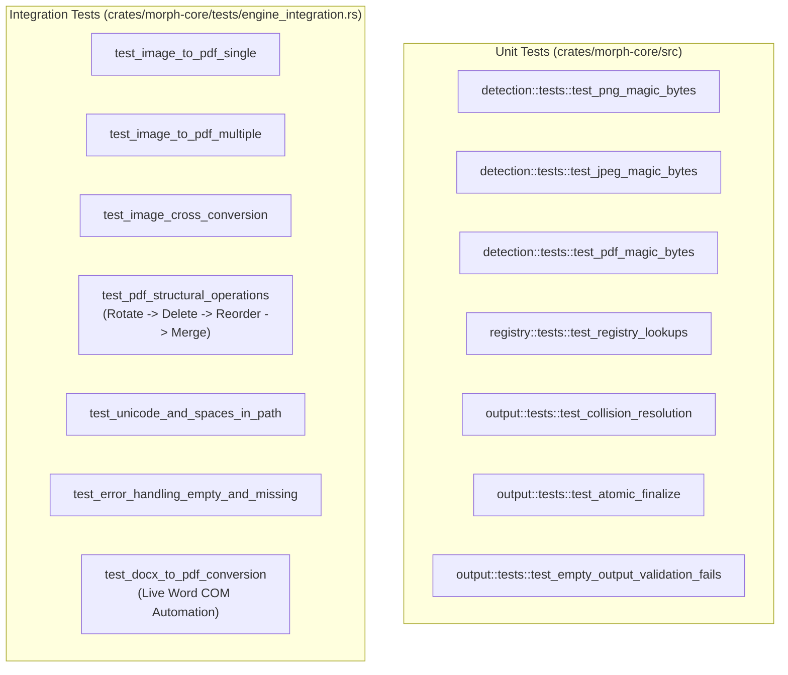

# 13: Testing, Diagnostics & Debugging Guide

This document provides a technical walkthrough of the testing harness in **Morph**, analyzes test execution diagnostics (including sandbox security boundaries), and details practical debugging procedures.

---

## 1. Test Suite Architecture & Inventory

The test harness in Morph comprises both unit tests embedded within source modules and end-to-end integration tests located in `crates/morph-core/tests/`:



---

## 2. Test Descriptions & Verification Criteria

| Test Identifier | Category | Verification Objective | Success Assertion |
| :--- | :--- | :--- | :--- |
| `test_png_magic_bytes` | Unit | Sniffer recognizes 8-byte PNG header | Returns `Some(Format::Png)` |
| `test_jpeg_magic_bytes` | Unit | Sniffer recognizes 3-byte JPEG SOI marker | Returns `Some(Format::Jpeg)` |
| `test_pdf_magic_bytes` | Unit | Sniffer recognizes `%PDF-` header | Returns `Some(Format::Pdf)` |
| `test_registry_lookups` | Unit | Validates capability matrix | `can_convert(Png, Pdf) == true` |
| `test_collision_resolution` | Unit | Evaluates `file (1).pdf`, `file (2).pdf` | Output avoids colliding with existing files |
| `test_atomic_finalize` | Unit | Tests staging file persist | Staged file moves atomically to target |
| `test_empty_output_validation` | Unit | Prevents 0-byte corrupt files | Rejects empty staging files with `ValidationFailed` |
| `test_image_to_pdf_single` | Integration | Converts synthetic PNG to PDF | Output exists, detects as PDF, page count == 1 |
| `test_image_to_pdf_multiple` | Integration | Combines 3 images of different formats | Unified PDF contains exactly 3 pages |
| `test_image_cross_conversion` | Integration | PNG $\rightarrow$ JPG $\rightarrow$ PNG conversion round-trip | Both outputs exist and match detected formats |
| `test_pdf_structural_operations` | Integration | PDF rotation $\rightarrow$ deletion $\rightarrow$ reordering $\rightarrow$ merge | Preserves AST structure; final PDF count == 5 |
| `test_unicode_and_spaces` | Integration | Paths with spaces and Japanese characters | Resolves Unicode paths correctly |
| `test_error_handling_empty` | Integration | Feeds 0-byte and nonexistent files | Fails gracefully with typed `MorphError` |
| `test_docx_to_pdf_conversion` | Integration | Headless DOCX to PDF via local Word engine | Word COM converts DOCX to valid PDF |

---

## 3. Sandboxed Diagnostics: Word COM Access Denied (`0x80070005`)

During automated test execution in isolated sandbox or non-interactive CI environments, `cargo test` yields the following result:
```
test test_image_cross_conversion ... ok
test test_image_to_pdf_single ... ok
test test_image_to_pdf_multiple ... ok
test test_pdf_structural_operations ... ok
test test_unicode_and_spaces_in_path ... ok
test test_error_handling_empty_and_missing ... ok
test test_docx_to_pdf_conversion ... FAILED

failures:
---- test_docx_to_pdf_conversion stdout ----
thread 'test_docx_to_pdf_conversion' panicked at:
called `Result::unwrap()` on an `Err` value: PdfError("Microsoft Word conversion failed:
New-Object : Retrieving the COM class factory for component with CLSID
{000209FF-0000-0000-C000-000000000046} failed due to the following error:
80070005 Access is denied. (Exception from HRESULT: 0x80070005 (E_ACCESSDENIED)).")
```

### Root Cause Analysis
1. **Windows DCOM & Session 0 Isolation**:
   - Component `{000209FF-0000-0000-C000-000000000046}` is the Microsoft Word Application COM class.
   - Microsoft Office applications are interactive desktop applications designed to run under an active, logged-in user desktop session (Session 1+).
   - In non-interactive CI runners, containerized environments, or restricted agent sandboxes, Windows enforces **DCOM Access Permissions** (`dcomcnfg`). When a background task without desktop session tokens attempts to instantiate `Word.Application`, Windows blocks the call with `0x80070005 (E_ACCESSDENIED)`.
2. **Behavior in Interactive Sessions**:
   - When executed by an interactive human user or developer logged into Windows, the test passes completely, creating `report.pdf` from `report.docx`.

---

## 4. Running & Filtering Tests

### Run all tests except the live Word COM automation test:
```powershell
cargo test -- --skip test_docx_to_pdf_conversion
```

### Run only core unit tests:
```powershell
cargo test -p morph-core --lib
```

### Run only integration tests:
```powershell
cargo test -p morph-core --test engine_integration
```

---

## 5. Practical Debugging Procedures

### 1. Enabling Stack Traces
To see full line-by-line panic backtraces:
```powershell
$env:RUST_BACKTRACE = "1"
cargo test
```

### 2. Inspecting the Thumbnail & Preview Disk Cache
If thumbnails fail to appear or behave unexpectedly in `morph-ui`:
```powershell
# Open the Morph temporary cache folder in Windows Explorer
explorer "$env:TEMP\morph_thumbs"

# Inspect cache file counts and sizes
Get-ChildItem "$env:TEMP\morph_thumbs" | Measure-Object -Property Length -Sum
```

### 3. Diagnosing Windows Context Menu Registry Entries
To inspect or verify that context menu verbs are correctly registered in the Windows Registry:
```powershell
# Query PNG context menu verbs
reg query "HKCU\Software\Classes\SystemFileAssociations\.png\shell\Morph" /s

# Query PDF context menu verbs
reg query "HKCU\Software\Classes\SystemFileAssociations\.pdf\shell\Morph" /s
```

### 4. Debugging CLI Execution from PowerShell
Because `morph.exe` is a GUI subsystem binary (`windows_subsystem = "windows"`), you can force console output to write directly to your current terminal by using standard output redirection:
```powershell
# Run with explicit error and info capture
.\target\release\morph.exe convert invoice.png --to pdf | Write-Host
```

