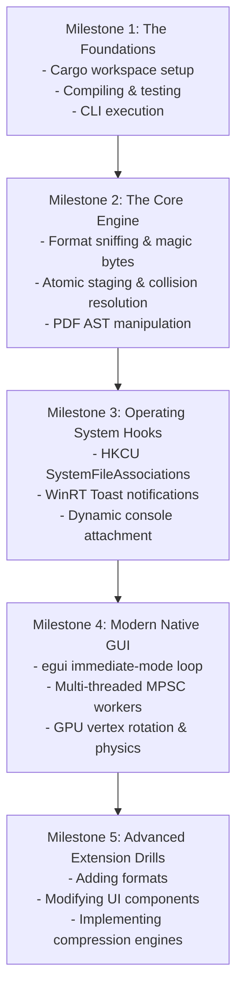

# 15: Complete Learning & Contributor Roadmap

This document serves as your guided, hands-on training curriculum. By working through the phases, code navigation drills, and practical modification challenges below, you will gain the mastery required to confidently explain, maintain, debug, and extend **Morph**.

---

## 🗺️ The Contributor Learning Progression



---

## Milestone 1: Environment & Codebase Verification

### Goals
1. Set up the local Rust MSVC toolchain.
2. Build and run both workspace binaries.
3. Verify test harness behavior.

### Practical Steps:
```powershell
# 1. Verify Rust compiler and linker
rustc -vV
cargo --version

# 2. Compile all targets in debug mode
cargo check --workspace

# 3. Run the core test suite (skipping live COM automation if running in a restricted sandbox)
cargo test -- --skip test_docx_to_pdf_conversion

# 4. Build release binaries
cargo build --release

# 5. Test CLI help output
.\target\release\morph.exe help

# 6. Launch the interactive editor
.\target\release\morph-ui.exe
```

---

## Milestone 2: Exploring Core Engine Mechanics (`morph-core`)

### Focus Files:
1. [`crates/morph-core/src/detection.rs`](file:///c:/Morph/crates/morph-core/src/detection.rs)
2. [`crates/morph-core/src/output.rs`](file:///c:/Morph/crates/morph-core/src/output.rs)
3. [`crates/morph-core/src/engines/image.rs`](file:///c:/Morph/crates/morph-core/src/engines/image.rs)
4. [`crates/morph-core/src/engines/pdf.rs`](file:///c:/Morph/crates/morph-core/src/engines/pdf.rs)

### Guided Code Navigation Drill:
1. Open `detection.rs` and trace how `detect_format_from_bytes` inspects the first 12 bytes to differentiate WebP from standard RIFF/WAV files.
2. Open `output.rs` and observe how `OutputManager::resolve_destination` handles collision naming (`stem (1).ext`) when the destination file already exists.
3. Open `engines/image.rs` and locate the JPEG passthrough optimization: see how it checks `\xFF\xD8\xFF` to bypass pixel decoding.
4. Open `engines/pdf.rs` and locate `doc.renumber_objects_with(max_id)` inside `merge_pdfs`: understand why object IDs must be re-indexed before merging two documents.

---

## Milestone 3: Mastering Windows Shell Integration (`morph-cli`)

### Focus Files:
1. [`crates/morph-cli/src/main.rs`](file:///c:/Morph/crates/morph-cli/src/main.rs)
2. [`crates/morph-cli/src/windows/context_menu.rs`](file:///c:/Morph/crates/morph-cli/src/windows/context_menu.rs)
3. [`crates/morph-cli/src/windows/notify.rs`](file:///c:/Morph/crates/morph-cli/src/windows/notify.rs)

### Guided Code Navigation Drill:
1. In `main.rs`, find `AttachConsole(ATTACH_PARENT_PROCESS)` and trace how `log_info!` redirects terminal output to `CONOUT$`.
2. In `context_menu.rs`, follow `register_current_exe()`: see how registry keys are written to `HKCU\Software\Classes\SystemFileAssociations`.
3. Locate `SHChangeNotify(0x08000000, 0, null, null)`: verify how the shell cache is invalidated immediately without requiring an explorer restart.
4. In `notify.rs`, inspect the PowerShell script generating WinRT toast notifications.

---

## Milestone 4: Mastering Native Desktop GUI Architecture (`morph-ui`)

### Focus Files:
1. [`crates/morph-ui/src/main.rs`](file:///c:/Morph/crates/morph-ui/src/main.rs)
2. [`crates/morph-ui/src/state/mod.rs`](file:///c:/Morph/crates/morph-ui/src/state/mod.rs)
3. [`crates/morph-ui/src/motion/mod.rs`](file:///c:/Morph/crates/morph-ui/src/motion/mod.rs)
4. [`crates/morph-ui/src/views/canvas.rs`](file:///c:/Morph/crates/morph-ui/src/views/canvas.rs)
5. [`crates/morph-ui/src/views/page_rail.rs`](file:///c:/Morph/crates/morph-ui/src/views/page_rail.rs)

### Guided Code Navigation Drill:
1. In `state/mod.rs`, trace the three worker threads spawned by `spawn_workers()` and see how `FileLoadRequest` messages move across the channel.
2. In `motion/mod.rs`, inspect the `Spring` struct and trace the `update(dt)` formula: observe how epsilon snapping halts repainting when settled.
3. In `views/canvas.rs`, inspect how `egui::Image::rotate` rotates the texture in hardware.
4. In `views/page_rail.rs`, trace `show_rows`: understand how virtualized scrolling renders hundreds of thumbnail cards without allocating off-screen widgets.

---

## Milestone 5: Practical Engineering Challenges

Put your knowledge into practice with these five hands-on extension exercises:

### Challenge 1: Add a Reset Zoom Keyboard Shortcut (`Ctrl+0`)
- **Objective**: In `crates/morph-ui/src/main.rs`, locate the global keyboard shortcuts section.
- **Task**: Add a listener for `egui::Key::Num0` while holding `Ctrl` that resets `self.zoom_spring.set_target(1.0)`.
- **Validation**: Launch `morph-ui`, zoom in to 250%, press `Ctrl+0`, and verify the canvas smoothly animates back to 100%.

---

### Challenge 2: Implement a `--grayscale` CLI Conversion Flag
- **Objective**: Allow users to convert images or PDFs to black-and-white grayscale via the CLI.
- **Task**:
  1. Add `--grayscale` parsing in `handle_convert` inside `crates/morph-cli/src/main.rs`.
  2. Extend `OutputOptions` or `ImageEngine::convert_image` to convert the decoded `DynamicImage` using `img.grayscale()`.
- **Validation**: Run `morph convert photo.png --to jpg --grayscale` and inspect the output image.

---

### Challenge 3: Add an Invert Colors Button to the Editor Toolbar
- **Objective**: Add a dark-mode inversion filter to the main document viewer.
- **Task**:
  1. In `crates/morph-ui/src/views/toolbar.rs`, add an `invert_colors` action flag.
  2. In `crates/morph-ui/src/views/canvas.rs`, tint the image or invert pixel rendering when enabled.

---

### Challenge 4: Implement Drag-and-Drop Page Reordering in the Page Rail
- **Objective**: Enable visual drag-and-drop reordering of page thumbnail cards.
- **Task**:
  1. In `crates/morph-ui/src/views/page_rail.rs`, detect card drag start (`card_resp.drag_started()`).
  2. Store the dragged page index in egui temporary memory.
  3. When dropped over another card (`card_resp.hovered() && ui.input(|i| i.pointer.any_released())`), emit `PageRailAction::reorder = Some((from_idx, to_idx))`.
  4. In `crates/morph-ui/src/main.rs`, call `self.reorder_page(from, to, now)`.

---

### Challenge 5: Implement PDF Stream Deduplication (Phase 6 Roadmap)
- **Objective**: Implement lossless Flate recompression and metadata pruning.
- **Task**:
  1. Create `crates/morph-core/src/engines/compress.rs`.
  2. Load a target PDF via `Document::load`.
  3. Traverse all stream objects in `doc.objects`, decompress them, and recompress with `flate2::Compression::best()`.
  4. Strip non-essential metadata streams (`/Metadata`, `/Thumb`).
  5. Save the optimized document and compare byte lengths.

