# Morph Codebase Deep-Dive: Master Learning & Architectural Guide

Welcome to the definitive, end-to-end technical documentation and training curriculum for **Morph**—a lightweight, offline-first, universal file conversion and document manipulation utility engineered in Rust for Microsoft Windows.

This documentation suite is organized as a comprehensive, modular textbook. It was authored to guide software engineers, systems programmers, and technical architects from fundamental computing concepts to advanced low-level PDF manipulation, Win32 shell integration, multi-threaded asynchronous UI architecture, and compiler toolchains.

---

## 🗺️ Master Curriculum & Navigation Index

Follow the documents in sequential order for a structured learning experience, or navigate directly to specific subsystem references:

```mermaid
flowchart TD
    Start["Begin Deep Dive"] --> P0["00-project-overview.md<br/><b>Vision & Value Proposition</b>"]
    P0 --> P1["01-complete-repository-structure.md<br/><b>Directory & File Inventory</b>"]
    P1 --> P2["02-programming-language-fundamentals.md<br/><b>Rust Language Mastery</b>"]
    P2 --> P3["03-frameworks-and-dependencies.md<br/><b>Crates & Library Ecosystem</b>"]
    P3 --> P4["04-system-architecture.md<br/><b>System Topology & Data Flow</b>"]
    P4 --> P5["05-application-initialization.md<br/><b>Process Entry & Runtime Startup</b>"]
    P5 --> P6["06-file-by-file-code-explanation.md<br/><b>Comprehensive Code Review</b>"]
    P6 --> P7["07-core-functionalities.md<br/><b>Engine Mechanics & Algorithms</b>"]
    P7 --> P8["08-end-to-end-execution-flows.md<br/><b>Lifecycle Sequence Traces</b>"]
    P8 --> P9["09-database-and-data-management.md<br/><b>State, PDF Graphs & Disk Cache</b>"]
    P9 --> P10["10-api-and-communication.md<br/><b>CLI Contracts, COM & MPSC IPC</b>"]
    P10 --> P11["11-configuration-build-and-deployment.md<br/><b>Cargo, WiX MSI & Inno Setup</b>"]
    P11 --> P12["12-security-and-performance.md<br/><b>Privacy, Atomicity & GPU Rotation</b>"]
    P12 --> P13["13-testing-and-debugging.md<br/><b>Test Harnesses & Diagnostics</b>"]
    P13 --> P14["14-glossary-and-technical-terminology.md<br/><b>Domain Dictionary & Standards</b>"]
    P14 --> P15["15-complete-learning-roadmap.md<br/><b>Practical Engineering Drills</b>"]
```



---

## 📚 Document Overview Table

| File | Title | Primary Focus | Key Concepts Covered |
| :--- | :--- | :--- | :--- |
| [**`00-project-overview.md`**](file:///c:/Morph/docs/codebase-deep-dive/00-project-overview.md) | Project Overview & Vision | High-level architectural purpose, problem space, design pillars | Offline-first, privacy, Windows Explorer integration, AI agent workflows, zero telemetry |
| [**`01-complete-repository-structure.md`**](file:///c:/Morph/docs/codebase-deep-dive/01-complete-repository-structure.md) | Complete Repository Structure | Comprehensive physical and logical codebase inventory | Cargo workspace members, crates, asset paths, installer targets, test fixtures |
| [**`02-programming-language-fundamentals.md`**](file:///c:/Morph/docs/codebase-deep-dive/02-programming-language-fundamentals.md) | Programming Language Fundamentals | Comprehensive Rust tutorial tailored to this codebase | Memory safety, ownership, borrowing, lifetimes, pattern matching, macros, FFI, traits |
| [**`03-frameworks-and-dependencies.md`**](file:///c:/Morph/docs/codebase-deep-dive/03-frameworks-and-dependencies.md) | Frameworks, Libraries & Dependencies | Exhaustive dependency analysis and internals | `egui`/`eframe`, `lopdf`, `pdf-writer`, `image`, `miniz_oxide`, `winreg`, `windows-sys`, `rfd` |
| [**`04-system-architecture.md`**](file:///c:/Morph/docs/codebase-deep-dive/04-system-architecture.md) | System Architecture & Topology | Three-tier decoupled workspace architecture | Engine abstraction, UI-engine isolation, capability registry, pipeline design |
| [**`05-application-initialization.md`**](file:///c:/Morph/docs/codebase-deep-dive/05-application-initialization.md) | Application Initialization | Bootstrap, environment binding, and event loop startup | `AttachConsole`, `windows_subsystem`, Win32 message pump, MPSC background threads |
| [**`06-file-by-file-code-explanation.md`**](file:///c:/Morph/docs/codebase-deep-dive/06-file-by-file-code-explanation.md) | File-by-File Code Walkthrough | Detailed, granular line-by-line code explanation | Every file across `morph-core`, `morph-cli`, `morph-ui`, build scripts, and installer sources |
| [**`07-core-functionalities.md`**](file:///c:/Morph/docs/codebase-deep-dive/07-core-functionalities.md) | Core Functionalities & Engines | Implementation details of each technical feature | Image raster conversion, DCT stream pass-through, soft-masking, structural PDF merge |
| [**`08-end-to-end-execution-flows.md`**](file:///c:/Morph/docs/codebase-deep-dive/08-end-to-end-execution-flows.md) | End-to-End Execution Flows | Sequential execution traces with visual diagrams | Context menu click, CLI merge, interactive multi-tab editing, background rendering |
| [**`09-database-and-data-management.md`**](file:///c:/Morph/docs/codebase-deep-dive/09-database-and-data-management.md) | Data Management & State Architecture | Memory models, PDF object trees, and cache hygiene | In-memory document state, `lopdf` dictionaries, temporary files, collision resolution |
| [**`10-api-and-communication.md`**](file:///c:/Morph/docs/codebase-deep-dive/10-api-and-communication.md) | API & Communication Protocols | CLI flags, Agent contracts, COM automation, and IPC | Machine-readable CLI exit codes, WinRT Toast notification IPC, thread messaging |
| [**`11-configuration-build-and-deployment.md`**](file:///c:/Morph/docs/codebase-deep-dive/11-configuration-build-and-deployment.md) | Build, Packaging & Deployment | Compiling, resource embedding, packaging pipelines | MSVC toolchain, PE header resources (`winres`), WiX v4 Toolset MSI, Inno Setup EXE |
| [**`12-security-and-performance.md`**](file:///c:/Morph/docs/codebase-deep-dive/12-security-and-performance.md) | Security, Integrity & Performance | Security threat models, sandboxing, and optimizations | Atomic file writes, path traversal prevention, magic bytes, 60 FPS GPU rotation |
| [**`13-testing-and-debugging.md`**](file:///c:/Morph/docs/codebase-deep-dive/13-testing-and-debugging.md) | Testing & Debugging Guide | Test harnesses, COM diagnostics, and debugging tools | Cargo test suite, sandbox COM permission analysis (`0x80070005`), `CONOUT$` logging |
| [**`14-glossary-and-technical-terminology.md`**](file:///c:/Morph/docs/codebase-deep-dive/14-glossary-and-technical-terminology.md) | Glossary & Technical Terminology | Exhaustive domain dictionary | Deflate, XObject, DCTDecode, Win32 PE, Registry Verbs, Spring Damping, Viewport |
| [**`15-complete-learning-roadmap.md`**](file:///c:/Morph/docs/codebase-deep-dive/15-complete-learning-roadmap.md) | Complete Learning & Extension Roadmap | Step-by-step master roadmap with guided exercises | Adding formats, modifying shaders, implementing compression, extending shell menus |

---

## 🛠️ Quick Verification & System Health

To verify your local repository environment before diving into the code:

```powershell
# 1. Check Rust toolchain (Requires 1.80+; recommended MSVC)
rustc --version
cargo --version

# 2. Run the core workspace test suite
cargo test --workspace

# 3. Build optimized release binaries
cargo build --release --workspace

# 4. Verify output binaries in target/release/
Get-Item .\target\release\morph.exe
Get-Item .\target\release\morph-ui.exe
```

> [!NOTE]
> During `cargo test`, `test_docx_to_pdf_conversion` exercises live Microsoft Word COM automation via PowerShell (`Word.Application`). In restricted sandbox or non-interactive CI environments without an active desktop session, COM elevation may yield `0x80070005 (E_ACCESSDENIED)`. This behavior and its mitigation are thoroughly analyzed in [**`13-testing-and-debugging.md`**](file:///c:/Morph/docs/codebase-deep-dive/13-testing-and-debugging.md).

